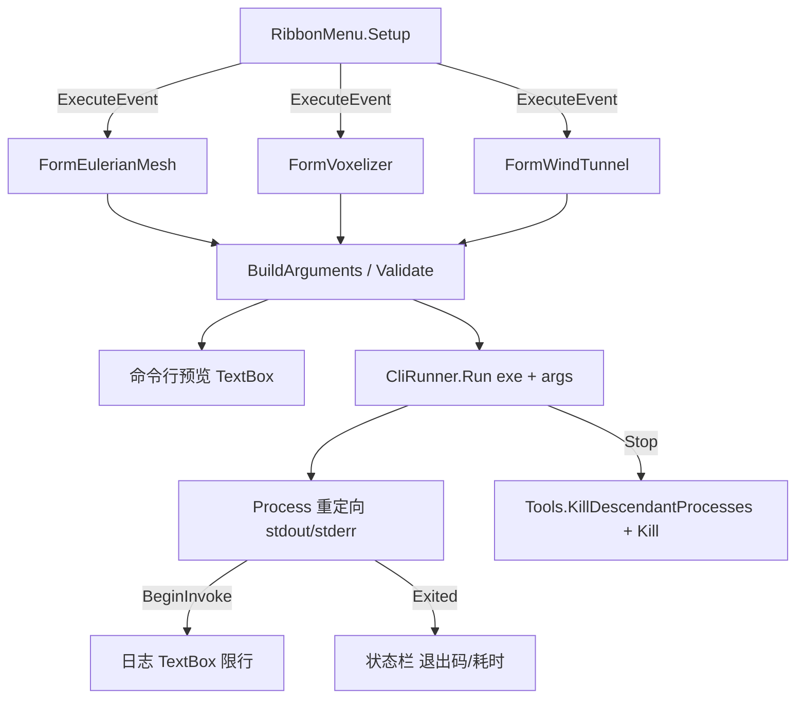

## 产品概述

在 `win32_desktop\CFD_win32.vbproj`（WinForms 工作台）的 `win32_desktop\Tools\` 文件夹下新建三个独立 WinForm 窗体，把三个已有命令行工具的全部参数图形化封装，用户点选/填参后一键调用，并在窗体内实时查看工具输出日志、随时中止。

## 核心功能

- **EulerianMesh 窗体**：三维模型文件（STL/OBJ/glTF/GLB/DAE/3DS/3MF）→ CFD Eulerian 网格包（.eulerian.zip）。覆盖 `maxres`（一键最高分辨率：单元预算、深度上限、域放大、体素比例、体素上限、干跑规划）与 `convert`（网格算法 octree/delaunay/structured/boundarylayer、分辨率、域放大、切割单元、Poisson 平滑轮数、关闭平滑）两套子命令，含 external/internal 域语义、内流次级实体列表、`名称:类型:盒面` 边界 Patch 规则列表、GPU 开关。
- **Voxelizer 窗体**：三维模型文件 → CFD 体素模型包（.voxel.zip / 兼容 .json）。覆盖模型文件、输出路径、体素化器（standard/sdf/physical/sdfraw）、最长边分辨率、物理体素尺寸、SDF 亚采样数、SDF 基准分辨率，并对 `sdfraw + 物理体素尺寸` 这一非法组合与 `.json` 输出的高分辨率内存风险给出前置提示。
- **WindTunnel 窗体**：CFD 模型文件 → 风洞/发酵罐模拟。覆盖 `windtunnel` 与 `tank` 两个子命令：网格 zip、输出目录、输出格式（vtu/vti/both）、物理模型、湍流模型、求解器、对流格式、可压缩通量格式、来流速度与方向、密度/粘度/压力/温度/马赫数、湍流强度与长度尺度、步数/时间步/CFL/欠松弛/压力迭代/快照间隔、参考面积与长度、探针点列表、GPU、报告与 verbose；tank 另有罐径/罐高/液位/转速/网格分辨率/切割单元/驱动强度/几何输出目录/网格另存。
- **通用交互**：参数区 + 只读"命令行预览"（参数变更即刷新，可复制）+ "运行/停止"按钮 + 实时滚动日志区（stdout/stderr 合并、限行防卡死）+ 状态栏（运行中/退出码/耗时）+ 打开输出目录；窗体关闭时自动终止子进程树。
- **入口**：接入 Ribbon 应用菜单中已存在但未接线的 `Eulerian Mesh` / `Voxelizer` / `WindTunnel` 三个按钮，非模态单实例打开。

## 技术栈

- 语言/框架：VB.NET（.NET 10 `net10.0-windows`）+ Windows Forms，沿用工程现有 SDK 风格项目与手写 Designer 约定；不新增任何工程引用（win32_desktop 未引用 ZMesh / FVMEngine / Landscape，进程调用可完全规避依赖面扩大）。
- 进程调用：`System.Diagnostics.Process`（重定向 stdout/stderr、`UseShellExecute=False`、`CreateNoWindow=True`）+ 事件式异步读取 + `Control.BeginInvoke` 回 UI 线程。
- 子进程树终止：复用 galaxy 已有的全局模块 `Tools.KillDescendantProcesses(parentProcessId)`（G:\galaxy\src\GalaxyWorkbench\Utils\Tools.vb，FormMain 已在用）。
- 目标 exe：`EulerianMesh.exe` / `Voxelizer.exe` / `WindTunnel.exe`，默认目录 `AppContext.BaseDirectory`（即 G:\Moira\assembly\bin，与 CFD_win32.exe 同目录），支持手动浏览改写。

## 实现思路

采用"**参数模型 → 命令行字符串 → 外部进程 → 日志回流**"的单向链路：每个窗体只负责（1）采集并校验参数、（2）拼出与 CLI 契约逐项对齐的实参串、（3）交给共用的 `CliRunner` 执行并回显。核心取舍：

- **外部进程 vs 库内直调**：选进程调用。库内直调需新增 ZMesh/FVMEngine/Landscape 引用（依赖面、构建时长、CUDA 初始化风险），且长任务需自行做后台线程与进度回调；进程调用天然隔离崩溃、可中途 kill、日志即 CLI 原文，且三个 exe 已随工程产物落盘，零新增依赖。代价是拿不到强类型结果——通过"命令行预览 + 退出码 + 输出目录打开"补偿。
- **不做可视继承基类**：派生窗体的可视化继承在 VB 设计器里易踩坑（基类控件可见性/初始化顺序）。改为"无 UI 依赖的 `CliRunner` 类 + 三窗体各自持有"，公共逻辑（引号包裹、不变文化数值格式化、日志限行、进程终止）集中一处，布局各自独立，符合 KISS 且编译风险最低。
- **数值与引号**：所有数值用 `CultureInfo.InvariantCulture` 格式化（CLI 侧以 InvariantCulture 解析）；所有路径统一加英文双引号。
- **性能与稳定性**：日志限行（保留最近 2000 行，超量按块截断）避免长时间运行（风洞 1500 步）把内存与 UI 拖垮；`Exited` 事件回填退出码并恢复按钮；`FormClosing` 若有存活进程先提示并 kill 进程树。

## 架构与数据流



## 目录结构

```
win32_desktop/
├── Tools/
│   ├── CliRunner.vb                     # [NEW] 无 UI 依赖的命令行执行器：Run(exePath, args, workDir) 启动 Process 并异步回流日志；Stop() 先 Tools.KillDescendantProcesses(proc.Id) 再 proc.Kill(True)；IsRunning；LogLine/Exited 事件；日志限行常量 MaxLogLines=2000。同时提供 Quote(path) 与 Num(value)（InvariantCulture）两个辅助函数。注意不得声明 Namespace Tools、不得命名类型 Tools（与 galaxy 全局模块 Tools 冲突）。
│   ├── FormEulerianMesh.vb              # [NEW] 窗体逻辑：子命令 maxres/convert 切换（切换时动态显示/隐藏对应参数区）；输入/输出文件选择（OpenFileDialog 过滤 STL/OBJ/glTF/GLB/DAE/3DS/3MF，SaveFileDialog 默认 *.eulerian.zip）；maxres 参数 cells/depth/domain-scale/voxel-ratio/max-voxels/plan/mode/internal-solid/patch/gpu；convert 参数 type/resolution/domain-scale/cut-cells/poisson/no-smooth/mode/internal-solid/patch/gpu；Patch 规则以“名称:类型:盒面”三元组加入列表（类型 Wall/Inlet/Outlet/Symmetry，盒面 XMin/XMax/YMin/YMax/ZMin/ZMax）；BuildArguments 与前置校验（resolution ∈ (0,1]、domain-scale ≥ 1、cells ≥ 8、voxel-ratio > 0）。
│   ├── FormEulerianMesh.Designer.vb     # [NEW] 手写 InitializeComponent：顶部标题 + 参数 GroupBox（TabControl 两页：maxres/convert）+ 文件浏览按钮 + Patch 列表（ListView/ListBox + 添加/删除）+ 命令行预览只读框 + 运行/停止按钮 + 多行只读日志框 + StatusStrip。
│   ├── FormEulerianMesh.resx            # [NEW] 最小标准 resx（供设计器承载）。
│   ├── FormVoxelizer.vb                 # [NEW] 窗体逻辑：模型文件（位置参数 0）、输出路径（-o，默认 .voxel.zip，另存 .json 时给出 OOM 提示）、体素化器下拉（standard/sdf/physical/sdfraw）、分辨率（默认 48）、物理体素尺寸（>0 时忽略分辨率）、亚采样（默认 2）、SDF 基准分辨率（0=自动）；校验 sdfraw 与 voxel-size>0 互斥、文件存在性。
│   ├── FormVoxelizer.Designer.vb        # [NEW] 对应布局：文件区 + 参数区 + 命令行预览 + 运行/停止 + 日志 + 状态栏。
│   ├── FormVoxelizer.resx               # [NEW] 最小标准 resx。
│   ├── FormWindTunnel.vb                # [NEW] 窗体逻辑：子命令 windtunnel/tank 切换（tank 参数组显隐）；网格 zip（windtunnel 必填）、输出目录、format、physics/turbulence/solver/scheme/flux、inlet-u/inlet-dir/rho/nu/p0/t0/mach/ti/tl、steps/dt/cfl/relax-u/p-iter/interval、ref-area/ref-length、probe 列表、gpu/no-gpu、report/verbose、transient/steady；tank：diameter/height/liquid-level/rpm/resolution/cut-cells/drive/geometry-dir/mesh-out。默认取值严格取自 CliOptions 默认值；数值仅在与默认不同或用户显式改动时才输出，保证命令行简洁可读。
│   ├── FormWindTunnel.Designer.vb       # [NEW] 对应布局：子命令区 + 通用参数 + 风洞/发酵罐分组 + 命令行预览 + 运行/停止 + 日志 + 状态栏。
│   └── FormWindTunnel.resx              # [NEW] 最小标准 resx。
├── Application/
│   └── RibbonMenu.vb                    # [MODIFY] Setup() 内为 ButtonEulerianMesh / ButtonVoxelizer / ButtonWindTunnel 挂 ExecuteEvent：单实例显示（已存在且未释放则 Activate，否则 New + Show(CommonRuntime.AppHost 主窗体)）。
└── CFD_win32.vbproj                     # [KEEP] SDK 默认 glob 自动包含 Tools\*.vb 与 *.resx，通常无需改动；仅当构建发现未包含时再显式加 Compile/EmbeddedResource 项。
```

## 关键代码结构

```
' Tools\CliRunner.vb（示意签名，实现时按此契约）
Friend Class CliRunner
    Public Const MaxLogLines As Integer = 2000
    Public Event LogLine(text As String)
    Public Event Exited(exitCode As Integer, elapsed As TimeSpan)
    Public ReadOnly Property IsRunning As Boolean
    Public Function Run(exePath As String, args As String, workDir As String) As Boolean
    Public Sub StopRunning()
End Class

Friend Module CliArg
    Public Function Quote(path As String) As String            ' 路径统一加双引号
    Public Function Num(value As Double) As String             ' InvariantCulture 格式化
    Public Function Flag(name As String, enabled As Boolean) As String
    Public Function Opt(name As String, value As String) As String  ' 空值/默认值不输出
End Module
```

## 执行注意事项

- **命名冲突**：galaxy 存在全局 `Public Module Tools`（含 KillDescendantProcesses）。新文件一律不加 `Namespace Tools`、类型名不得为 `Tools`；窗体类名用 `FormEulerianMesh` / `FormVoxelizer` / `FormWindTunnel`。文件落在 `CFD_win32` 根命名空间（VB SDK 不按文件夹附加命名空间，与现有 Pages/Forms 一致）。
- **VB 陷阱**：局部变量不要与类型名仅大小写不同；不用 `set` 等保留字作参数名；`Math.xxx` 一律写 `System.Math.xxx` 防遮蔽；`System.Windows.Forms` / `System.Drawing` 已由项目级 Import 引入，无需重复 Imports。
- **文档警告**：项目 `GenerateDocumentationFile=True`，公开成员建议补 XML 注释或保持 `Friend`，避免 BC42304 注释警告噪音；不得让警告升级为错误。
- **兼容性**：不改动现有窗体/引擎逻辑，仅在 RibbonMenu 追加三行 AddHandler，波及面可控；三个 exe 缺失时给出"未找到工具，请手动指定"的文件选择回退，不抛异常。
- **UI 线程安全**：日志回调全部走 `BeginInvoke`；运行期间禁用参数区与运行按钮，仅保留停止按钮。

## 验证

- `dotnet build g:\Moira\win32_desktop\CFD_win32.vbproj -c Debug`（先记录基线是否可编译；输出目录为 G:\Moira\assembly\bin，会覆盖 CFD_win32.exe）。
- 冒烟：三个窗体各自拼出的命令行串与对应 CLI 的 `--help` / Usage 逐项对照；`EulerianMesh.exe --help`、`Voxelizer.exe -h`、`WindTunnel.exe --help` 确认 exe 可启动。

## 设计风格

沿用工作台既有的 VS2015 Light 浅色工程化风格：浅灰底 + 白色卡片分组 + 蓝色主按钮，信息密度优先，控件对齐到统一网格，不使用圆角阴影等无谓装饰。三个窗体保持完全一致的骨架（标题区 / 参数区 / 命令行预览 / 运行控制 / 日志区 / 状态栏），只替换参数区内容，形成可识别的"CFD 工具"家族感。

## 页面规划（3 屏）

**1. Eulerian Mesh 转换窗体**：顶部标题与工具说明；子命令 Tab（maxres 一键最高精度 / convert 自定义）参数区，文件行带"..."浏览按钮；边界 Patch 规则列表（添加/删除）；只读命令行预览（等宽字体、灰底）；底部运行/停止按钮 + 打开输出目录；下半部深色多行日志区与状态栏（运行中/退出码/耗时）。

**2. Voxelizer 体素化窗体**：同骨架；参数区为模型文件、输出路径、体素化器下拉、分辨率与物理体素尺寸（二选一联动，另一项自动置灰）、SDF 亚采样与基准分辨率（仅 sdf/sdfraw 可用）；非法组合与 .json 高分辨率风险以行内提示色文字即时反馈。

**3. WindTunnel 模拟窗体**：同骨架；子命令切换 windtunnel / tank 决定参数分组显隐；通用参数（网格、输出、格式、步数、GPU）常驻，物理/湍流/格式一组，来流与物性一组，tank 几何与搅拌一组；探针点列表支持多个 x,y,z 添加。

## 交互

参数变更即时刷新命令行预览；运行期间参数区只读、按钮切换为停止（红色）；日志自动滚动并限行；退出码非 0 时状态栏变红并提示查看日志；窗体关闭时若进程存活先终止进程树。

## Agent Extensions

### Skill

- **lsp-code-analysis**
- Purpose：核对 `RibbonItems.Designer.vb` 中 ButtonEulerianMesh / ButtonVoxelizer / ButtonWindTunnel 的属性与 `RibbonButton.ExecuteEvent` 事件签名，以及构建报错处符号定位。
- Expected outcome：Ribbon 接线一次写对，编译错误能快速定位到具体符号与文件。

### SubAgent

- **code-explorer**
- Purpose：实现阶段如需复核 CLI 参数默认值与枚举取值（CliOptions、EulerianPatchType、BoxFace）时做定点检索。
- Expected outcome：UI 默认值与 CLI 默认值逐项一致，不出现拼写或取值偏差。