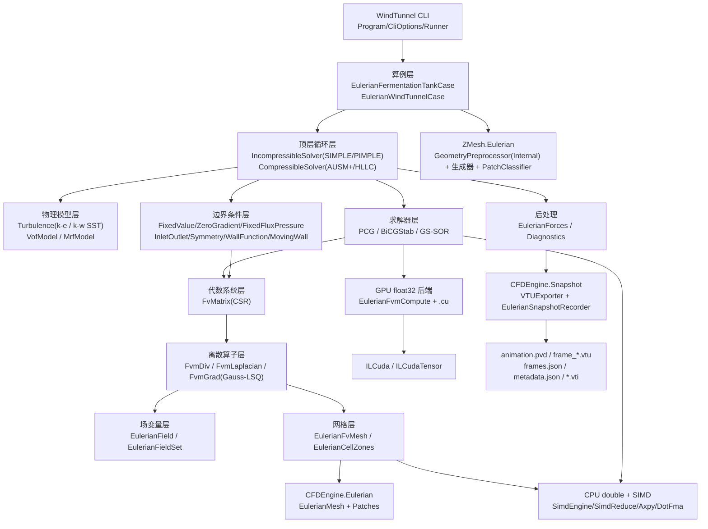

## 产品概述

在现有 VB.NET CFD 计算引擎中，为 `src\FVMEngine` 新增一套以「Eulerian 网格模型」为几何基础的通用三维 FVM CFD 求解能力，替代现有仅支持体素模型、精度不足的算法路径，并配套交付可直接在生产环境使用的命令行求解工具、可视化数据输出与自测验收体系。

## 核心功能

- **Eulerian 非结构网格求解内核**：直接消费 `src\CFDEngine\Eulerian` 的多面体/四面体/六面体/棱柱网格与 patch 定义，完成控制体积离散、压力-速度耦合与时间推进。
- **两套物理体系**：不可压（稳态 SIMPLE / 瞬态 PIMPLE，含 Rhie-Chow 去棋盘振荡）与可压缩（AUSM+ / HLLC 通量分裂 + 密度基/压力基耦合），可算 F1 车身局部跨声速与激波。
- **湍流模型**：标准 k-ε 与 k-ω SST 双模型（含近壁面壁面函数），覆盖 F1 后翼/扩散器与建筑侧风分离流。
- **三维发酵罐搅拌仿真**：发酵液体积占罐体 2/3（液面在罐高 2/3 处），桨叶用 MRF 旋转区驱动，液面用 VOF 两相真实追踪，含表面张力与搅拌功率等诊断。
- **风洞气动仿真**：支持 F1 赛车、飞机、城市建筑群的绕流计算，输出 Cd/Cl/Cm 力系数、流量与探针曲线。
- **混合精度计算**：迭代求解等计算热点以 float 单精度在 GPU 执行，网格几何、系数组装、边界、湍流与 VOF 等主体逻辑以 double 在 CPU 执行并使用 SIMD 加速；无 CUDA 环境时自动回落纯 CPU 路径，结果保持一致。
- **结果可视化输出**：求解结果按帧输出非结构网格动画序列（含 `animation.pvd`、帧文件、`frames.json`、`metadata.json`），并在盒式风洞域上额外汇出结构化 `vti` 动画序列，均可在 ParaView 中直接播放查看速度/压力/湍流动能/相分数等场随时间演化的动画效果。
- **生产级命令行工具**：接收由 `src\EulerianMesh` 工具转换好的 Eulerian 网格文件路径，通过命令行设置物理模型、来流条件、湍流模型、松弛因子、时间步、采样间隔与输出目录，完成求解并落盘动画序列。
- **自测与验收**：新增自测工程，覆盖解析基准（MMS、驱动方腔、激波管、静水压力平衡、搅拌功率）与 `Custom_F1_2022_3D.stl` 端到端风洞算例。

## 技术栈

- 语言/框架：VB.NET（沿用 `OptionStrict=Off`、`Imports std = System.Math` 等既有约定），.NET `net10.0`，SDK 风格 `vbproj`
- 复用工程：`src\CFDEngine`（`Eulerian` 网格层、`Snapshot` 快照层、`FluidField`/`VoxelShape`）、`src\ZMesh`（`Landscape` 模型加载 + `Eulerian` 网格生成）、`src\FVMEngine`（既有体素求解器，不改动）
- 计算后端：`TensorF`/`ITensorComputeF`（float32 SIMD 栈）、`Tensor`/`ITensorCompute`（double 栈）、`Microsoft.VisualBasic.Math.SIMD`（`SimdEngine`/`SimdReduce`/`SIMDIntrinsics.Axpy/DotFma`/`SimdParallel`）、`ILCuda`/`ILCudaTensor`（`CudaEngine`、`KernelSources`、`DeviceBuffer(Of T)`、`LaunchPlanner.For1D`）
- 禁止项：不扩展 `ITensorComputeF` 公共契约（会波及 GCModeller 其它工程），GPU 后端独立实现，沿用 `FvmCompute`/`CudaLbmBackend` 已验证的「注册内核源码 → `TryCreate` → `DeviceBuffer` → `For1D` 启动 → 失败自动回落 CPU」模式

## 实施方案

以 `docs\FVM_Eulerian.md` 的六层架构（网格层 / 场变量层 / 离散算子层 / 代数系统层 / 求解器层 / 顶层循环层）为蓝本，在 `src\FVMEngine\Eulerian\` 内新增独立命名空间 `Moira.FVMEngine.Eulerian` 与独立子目录，与既有体素求解器完全隔离。

**关键决策与理由**

1. **面基拓扑 + cell-centered 场**：直接映射 `EulerianMesh` 既有的 `Faces(Owner/Neighbour)/CellFaces/Patches` 与 `ComputeGeometry` 结果；`EulerianMesh` 已有的体积/形心/面法向/面心不改动，仅在其外侧新增 FVM 必需的 `d` 向量、面插值权重 `w_f`、非正交修正向量与单元-单元邻接 CSR。
2. **CSR 结构一次构建、多次复用**：网格无关性最强的加速点是「稀疏结构固定、仅数值变化」。在网格预处理阶段一次性生成 `rowPtr/colIdx`（行内按邻元排序），每个方程每次外迭代只重填 `values`；这套 CSR 同时服务 CPU 与 GPU 两条路径。
3. **混合精度分层（核心契约）**：

- **double（CPU）**：网格几何与非正交修正、fvMatrix 系数组装、边界条件贡献、湍流源项与闭包（含 `exp/pow`）、VOF 界面处理与 MULES 限制器、时间推进与外循环耦合、所有比值型诊断量、收敛残差重算。
- **float32（GPU）**：内迭代线性求解热点——CSR SpMV、Jacobi/Gauss-Seidel 扫描、`axpy`、`dot`/`norm2`、VOF 界面压缩扫描、面通量散度累加。
- 数据边界：CPU 组装 `values`/`rhs`（Double）→ 转 Single 上传设备 → 显存内 ping-pong 迭代（主机只一次上传/一次回读）→ 解回读为 Double → 残差在 Double 下重算用于收敛判定。精度可复现性由「CPU double 参考路径 + 自动回落」保证，自测可做容差对比。

4. **非正交网格处理**：扩散项拆为「正交隐式贡献进 fvMatrix + 非正交显式延迟修正进源项」，每次外迭代用上一轮场值更新修正项，兼顾稳定性与精度。
5. **线性求解器选型**：压力 Poisson（对称正定）用 PCG（DIC/Jacobi 预条件）；动量与标量输运（非对称）用 BiCGStab（ILU0/Jacobi 预条件）；Jacobi/Gauss-Seidel/SOR 作为平滑器；收敛采用「初始残差 + 起始残差归一化，下降 3-4 量级或绝对残差 < 1e-6」。
6. **发酵罐内流域的网格获取（重要设计点）**：现有 `GeometryPreprocessor` 是「外流」语义（模型内部=固体，盒子其余=流体），直接用于发酵罐会得到错误域。因此新增 **DomainMode = External | Internal** 与**多实体分组**能力：内流模式下，容器外壳闭合面内部为流体、挡板/桨叶/轴等次级实体内部为固体、域外格点剔除；配套扩展 patch 名称映射（vessel→Wall、baffle→Wall、impeller→MovingWall、shaft→Wall）。STL 以多 `solid` 块分组表达各部件（`LoadModel` 返回的 `SceneModel.Surfaces` 数组可依此分组）。
7. **发酵罐物理组合**：MRF 旋转参考系（绝对系下施加 `-ρ(2Ω×U + Ω×(Ω×r))` 科氏/离心源项）+ 桨叶面 moving-wall 条件（`u = Ω×r`）驱动搅拌；自由液面用 VOF α 输运 + 界面压缩（MULES-lite，显式有界）+ CSF 表面张力；初始 α 场按「液面高度 = 罐高 2/3」设定（圆柱罐中体积分数与高度成正比，即 2/3 体积 ⇔ 2/3 高度）。几何由 FVMEngine 内自包含的 ASCII STL 写出器生成（不引入 Landscape 依赖），网格转换由持有 ZMesh 的调用方（CLI / 自测）执行。
8. **快照对接（关键技术冲突的解决）**：VTK ImageData(`.vti`) 在数学上无法表达多面体单元。方案为：①在 `src\CFDEngine\Snapshot\` 新增 `VTUExporter`（VTK XML UnstructuredGrid，`VTK_POLYHEDRON` + `Faces`/`FaceOffsets` 连接表，支持任意面数）输出 `.vtu` 帧；②新增 `EulerianSnapshotRecorder`（实现新增的 `IEulerianSnapshotRecorder`，签名面向「网格 + 单元场」，因既有 `ISnapshotRecorder.Capture(field As FluidField,...)` 是体素导向的）并复用完全相同的 `animation.pvd` + `frames.json` + `metadata.json` 约定（下游工具链零改动）；③对**盒式风洞域**额外提供「Eulerian 解 → 结构笛卡尔格重采样」（`EulerianToCartesianResampler` + `EulerianVtiRecorder`），从而仍能产出真正的 `.vti` 动画序列，满足用户显式要求。既有 `VTIExporter`/`VtiSnapshotRecorder`/`TankVtiRecorder` 一律不改行为，仅把 pvd/frames.json 写出逻辑抽到共享 helper 供两者复用。
9. **性能预估**：以 F1 模型 `resolution≈0.02` 计约 2×10^6 单元，每个内部面承载一个非零系数，CSR nnz≈10^7。CPU double 组装为 O(nnz) 线性、可 SIMD/并行；GPU 单次 PCG 迭代约 2 次 SpMV + 2 次 dot + 2 次 axpy（O(nnz)），显存占用 ≈ `nnz×(4+4) 字节 + 若干 O(n) 向量`，2M 单元量级约数百 MB，可容纳。瓶颈在组装与 H↔D 拷贝，故采用「一次上传、多次显存内迭代」规避。
10. **技术债控制**：全部新增能力以「新文件 + 新命名空间 + 显式可选参数」方式落地；对 `EulerianMeshPackage`、`MeshGenerateOptions`、`SnapshotMetadata` 的扩展均为向后兼容的可选项（缺省即旧行为）。

## 架构设计



## 实施注意事项

- **不改动既有行为**：`FvmSolver/FvmTank/PhysicsModels/PopulationBalance/TankVtiRecorder` 保持逐字不变；不修改 `win32_desktop.sln` 之外无关工程。
- **VB 陷阱清单（本项目已踩过，必须遵守）**：`Module` 成员不能加 `Shared`；`Parallel` 需全限定 `Microsoft.VisualBasic.Parallel`；局部变量不得与类型名或类字段仅大小写不同（会静默产生错值）；裸 `Math.xxx` 可能被遮蔽；`List(Of T).Count(lambda)` 会解析到 `Count` 属性，须用 `.Where().Count()`；VB 参数名不能用保留字 `set`；`JsonSerializerOptions` 必须 `IncludeFields:=True`；`DeflateStream` 不支持 `Length/Position`，二进制条目先读入 `MemoryStream`。
- **命名空间**：新文件用 `Namespace Eulerian`（受 `RootNamespace=Moira.FVMEngine` 前缀，得 `Moira.FVMEngine.Eulerian`）；快照新文件沿用 `Namespace Snapshot`。
- **GPU 内核注册顺序**：`KernelSources.RegisterSource` 必须在 `CudaEngine.TryCreate` 之前；`LaunchPlanner` 只有 `For1D/For2D`，3D 一律扁平化 `For1D(n, 256)`；内核参数仅支持 `DeviceBuffer/Single/Double/Integer/Long/IntPtr/Nothing`。
- **数值稳健性**：`ComputeGeometry` 的散度定理体积对退化单元可能接近 0，需在 `EulerianFvMesh` 中做体积下限校验并给出可读诊断；非正交修正必须延迟显式处理，否则易发散；SIMPLE 欠松弛速度 0.7 / 压力 0.3。
- **日志与诊断**：每个外迭代输出归一化残差（不打印大数组）；`--verbose` 才输出逐方程残差历史；错误信息需含网格名、单元数、方程名与最小残差，便于生产排障。
- **部署**：`src\WindTunnel` 参考 `src\Voxelizer\Voxelizer.vbproj` 写法设 `AppendTargetFrameworkToOutputPath=false` + `OutputPath=G:\Moira\assembly\bin`（各配置），确保 `*.runtimeconfig.json` 与 `*.deps.json` 同时落盘，避免运行退出码 `0x80008083`。
- **性能**：避免每次迭代重建 CSR 结构与设备缓冲（缓存于 `EulerianFvMesh` 与设备状态对象）；避免在热循环内装箱/`ParamArray`；主机-设备拷贝按「一次上传一次回读」合并。

## 目录结构

```
Moira/
├── src/
│   ├── FVMEngine/
│   │   ├── FVMEngine.vbproj                 # [MODIFY] 新增 <EmbeddedResource Include="Kernels\*.cu" />；其余保持不变
│   │   ├── FvmSolver.vb 等                  # [KEEP] 既有体素求解器，逐字不动
│   │   ├── Kernels/
│   │   │   └── moira_eulerian_fvm_f32.cu    # [NEW] float32 CUDA 内核：spmv_csr_f32 / jacobi_csr_f32 /
│   │   │                                    #       gs_forward_f32 / gs_backward_f32 / axpy_f32 / dot_f32 /
│   │   │                                    #       norm2_f32 / face_flux_div_f32 / vof_compress_f32。
│   │   │                                    #       布局 idx=(i*ny+j)*nz+k 风格不适用，按 CSR 行主序；网格参数扁平化传入。
│   │   └── Eulerian/                        # [NEW] 全部新增，命名空间 Moira.FVMEngine.Eulerian
│   │       ├── EulerianFvMesh.vb            # [NEW] 网格层：包装 Moira.CFDEngine.Eulerian.EulerianMesh；
│   │       │                                #   预计算 d 向量 / 面插值权重 w_f / 非正交修正向量 / Sf 面积向量 /
│   │       │                                #   owner-neighbour 面表 / 单元-面与单元-单元 CSR 邻接 / 单元质量统计
│   │       │                                #   （体积下限校验、非正交角、长宽比）；提供 patch→面索引映射。
│   │       ├── EulerianCellZones.vb         # [NEW] 单元区域：MRF 桨区（圆柱轴向/半径/z 区间/Ω）、液区、探针区；
│   │       │                                #   按几何判据标记 per-cell zone id；支持从 CLI 参数或 sidecar JSON 构建。
│   │       ├── EulerianField.vb             # [NEW] 场变量层：cell-centered 标量/向量场（Double 主存储）+ patch 边界值场；
│   │       │                                #   ToSingle/FromSingle 混合精度转换；EulerianFieldSet 聚合 U/p/T/k/ω(ε)/α/ρ/μ。
│   │       ├── EulerianBoundaryField.vb     # [NEW] patch 边界场容器：逐面边界值 + 关联 EulerianBoundaryCondition。
│   │       ├── EulerianBoundaryCondition.vb # [NEW] 边界条件框架：抽象基类 + FixedValueBc / FixedGradientBc /
│   │       │                                #   ZeroGradientBc / FixedFluxPressureBc / InletOutletBc / SymmetryBc /
│   │       │                                #   WallFunctionBc / MovingWallBc / TotalPressureTemperatureBc；
│   │       │                                #   每个 BC 提供 UpdateCoefficients(fvMatrix, field) 贡献对角与源项、value()、gradient()。
│   │       ├── FvMatrix.vb                  # [NEW] 代数系统层：CSR 稀疏矩阵（结构缓存 rowPtr/colIdx/对偶索引、
│   │       │                                #   values、diag、b）；Relax(α)、A()、H()、SetReference(cell,value)、
│   │       │                                #   AddBoundaryContribution、Symmetric(cell,face) 对称化辅助。
│   │       ├── EulerianOperators.vb         # [NEW] 离散算子层：FvmDiv(迎风/中心/QUICK/van Leer TVD)、FvmLaplacian
│   │       │                                #   （正交隐式 + 非正交显式修正）、FvmGrad / FvcGrad（Gauss-LSQ 与 Gauss-Green）、
│   │       │                                #   FvcInterpolate、RhieChowFlux、FvcDiv（显式散度/通量求和）。
│   │       ├── EulerianLinearSolver.vb      # [NEW] 求解器层：PCG(DIC/Jacobi)、BiCGStab(ILU0/Jacobi)、
│   │       │                                #   Jacobi/GS/SOR 平滑器、归一化残差监控与收敛判据、迭代计数/历史。
│   │       ├── EulerianFvmCompute.vb        # [NEW] GPU float32 后端 Module：TryRegister/Unregister/IsGpuAvailable/
│   │       │                                #   LastError；设备状态（CSR 值/列索引/行指针、x/r/p/Ap 向量、diag）；
│   │       │                                #   Spmv / JacobiSweep / GsSweep / Axpy / Dot / Norm2 / VofCompress；
│   │       │                                #   主机-设备一次上传一次回读；GPU 不可用时回落等价 double CPU 路径。
│   │       ├── IncompressibleSolver.vb      # [NEW] 顶层循环层：SIMPLE（稳态）与 PIMPLE（瞬态，PISO 内循环 + SIMPLE 外循环
│   │       │                                #   + 欠松弛）；动量预测 → 通量 → p' Poisson（Rhie-Chow）→ 速度/通量校正 → 收敛检查；
│   │       │                                #   多相/湍流方程挂载点。
│   │       ├── CompressibleSolver.vb        # [NEW] 可压缩求解器：IFluxScheme 抽象 + AusmPlusFlux / HllcFlux（熵修正），
│   │       │                                #   MUSCL + van Leer/Venkatakrishnan 限制器重构、局部时间步长、显式 RK 与隐式 LU-SGS、
│   │       │                                #   双时间推进；给出 Ma 场与总压总温边界。
│   │       ├── TurbulenceModel.vb           # [NEW] ITurbulenceModel 抽象 + KEpsilonModel（Cmu=0.09/Ce1=1.44/Ce2=1.92/
│   │       │                                #   Sigmak=1.0/Sigmae=1.3，高 Re 壁面函数）+ KOmegaSSTModel（混合函数 + y+ 不敏感
│   │       │                                #   壁面处理）；nut 场输出。
│   │       ├── EulerianWallDistance.vb      # [NEW] 壁面距离场：基于既有 Octree 或 Eikonal/Fast-Marching 在单元邻接图上求解，
│   │       │                                #   供 SST 与壁面函数使用。
│   │       ├── VofModel.vb                  # [NEW] VOF：α 输运（守恒形式）+ 界面压缩（MULES-lite 显式有界限制器，
│   │       │                                #   预留 IVofReconstruction 扩展点以便日后接 PLIC）+ CSF 表面张力 +
│   │       │                                #   两相混合 ρ/μ；按「液面高度 = 罐高 2/3」初始化 α。
│   │       ├── MrfModel.vb                  # [NEW] MRF 旋转参考系：绝对系下科氏/离心源项 + 桨叶 moving-wall 相对速度；
│   │       │                                #   与 EulerianCellZones 的桨区联动。
│   │       ├── EulerianFermentationTankCase.vb # [NEW] 发酵罐算例：自包含 ASCII STL 写出器（容器外壳/挡板/桨叶/轴分块），
│   │       │                                #   几何参数复用 FvmTank 的 Rushton 构型；产出 patch 规则 + zone 规格 +
│   │       │                                #   2/3 液位 VOF 初值与求解配置。
│   │       ├── EulerianWindTunnelCase.vb    # [NEW] 风洞算例：从既有 Eulerian 网格 zip 构建；应用 inlet/outlet/ground/
│   │       │                                #   top/symmetry 边界与来流湍流入口；装配力系数监控与探针；支持 F1/飞机/建筑群。
│   │       ├── EulerianForces.vb            # [NEW] 后处理：壁面 patch 压力力 + 黏性摩擦应力积分 → Cd/Cl/Cm 与逐 patch 分力。
│   │       └── EulerianDiagnostics.vb       # [NEW] 后处理：进出口质量流量与不平衡、残差历史、点/线探针采样、搅拌功率数。
│   ├── CFDEngine/
│   │   ├── Eulerian/
│   │   │   └── EulerianMeshPackage.vb       # [MODIFY] 可选新增网格内 cell zone 条目（mesh.zones），缺省不写；
│   │   │                                    #   读取侧向后兼容旧包；沿用 IncludeFields:=True 与 MemoryStream 约定。
│   │   └── Snapshot/
│   │       ├── VTUExporter.vb               # [NEW] VTK XML UnstructuredGrid 导出器：任意面数 → VTK_POLYHEDRON
│   │       │                                #   （Faces/FaceOffsets）+ CellData/PointData（velocity/pressure/k/nut/alpha/rho…）；
│   │       │                                #   可选 CellData→PointData 平均；可选 zlib 分块压缩。
│   │       ├── IEulerianSnapshotRecorder.vb # [NEW] 非结构网格快照接口：OutputDir/FrameCount/Capture(mesh, fields, step, time)/Finish。
│   │       ├── SnapshotCollectionWriter.vb  # [NEW] 共享写出器：animation.pvd + frames.json + metadata.json
│   │       │                                #   （从 VtiSnapshotRecorder 抽取，后者改为调用它，逐字保持既有输出）。
│   │       ├── EulerianSnapshotRecorder.vb  # [NEW] 实现 IEulerianSnapshotRecorder，逐帧写 frame_*.vtu。
│   │       ├── EulerianToCartesianResampler.vb # [NEW] 把 Eulerian 单元值重采样到用户指定结构化笛卡尔格
│   │       │                                #   （origin + spacing + nx,ny,nz），供盒式风洞域使用。
│   │       ├── EulerianVtiRecorder.vb       # [NEW] 基于重采样器输出真正的 .vti 动画序列（复用 VTIExporter 与共享写出器）。
│   │       └── JSON/EulerianSnapshotMetadata.vb # [NEW] 非结构网格元数据（单元数/面数/patch 表/生成器/求解配置），
│   │                                            #   不改动既有 SnapshotMetadata。
│   ├── ZMesh/
│   │   └── Eulerian/
│   │       ├── GeometryPreprocessor.vb      # [MODIFY] 新增 DomainMode(External|Internal) 与多实体分组：
│   │       │                                #   内流模式下「容器外壳内=流体、次级实体(挡板/桨叶/轴)内=固体、域外剔除」；
│   │       │                                #   按 SceneModel.Surfaces 分组分别体素化后组合；External 为缺省，旧行为零回归。
│   │       ├── MeshGenerators/IMeshGenerator.vb # [MODIFY] MeshGenerateOptions 新增 DomainMode / SurfaceGroupRules；
│   │       │                                #   缺省值即旧行为。
│   │       ├── MeshGenerators/OctreeCutCellGenerator.vb # [MODIFY] 支持内流模式单元分类（fluid/wall/excluded）与
│   │       │                                            #   分组 Tag 传递（用于后续 patch 命名）。
│   │       └── PatchClassifier.vb           # [MODIFY] 扩展名称→类型映射与分组规则：vessel/baffle/shaft→Wall、
│   │                                        #   impeller→Wall（由求解器按名识别为 MovingWall）、原有 AutoPatchName 保持不变。
│   └── WindTunnel/
│       ├── WindTunnel.vbproj                # [MODIFY] AssemblyName=WindTunnel；AppendTargetFrameworkToOutputPath=false；
│       │                                    #   各配置 OutputPath=G:\Moira\assembly\bin；保证 runtimeconfig/deps.json 落盘。
│       ├── Program.vb                       # [MODIFY] 替换 Hello World：入口，分派 windtunnel / tank 两个子命令，设置退出码。
│       ├── CliOptions.vb                    # [NEW] 参数模型与解析（--mesh/--case/--physics/--turbulence/--inlet-u/--inlet-dir/
│       │                                    #   --nu/--rho/--p0/--t0/--steps/--dt/--iterations/--relax-u/--relax-p/
│       │                                    #   --solver/--scheme/--order/--out/--interval/--gpu|--no-gpu/--report/--probe/
│       │                                    #   --mrf/--liquid-level/--format vtu|vti|both/--resample/--verbose/--help），
│       │                                    #   风格对齐 src\EulerianMesh\Program.vb 与 src\FVMEngine\test\Program.vb。
│       └── WindTunnelRunner.vb              # [NEW] 编排：加载网格 zip → 构建算例 → GPU 注册（可选）→ 求解主循环
│                                            #   → 逐帧快照 → 收敛后输出 Cd/Cl/Cm 与流量报告 → 落盘 summary.json。
└── test/
    └── EulerianFvmSelfTest/                 # [NEW] 自测工程（手写 Check 断言 + failures 计数 + Environment.ExitCode）
        ├── EulerianFvmSelfTest.vbproj       # [NEW] ProjectReference: FVMEngine / CFDEngine / ZMesh；输出 bin\Debug\net10.0。
        └── Program.vb                       # [NEW] 断言集：几何/CSR 结构正确性、MMS 泊松与对流-扩散收敛阶、
                                             #   驱动方腔 Ghia 基准（Re=100/1000）、管道/后台阶、可压缩激波管(Sod)、
                                             #   VOF 静水压力平衡与 2/3 液位体积守恒、MRF 搅拌功率数量级、
                                             #   GPU/CPU 双路径容差一致性、F1 端到端风洞（ZMesh 生成网格→求解→写帧
                                             #   →断言残差下降 3 量级、Cd 为有限正值、帧文件与 pvd 齐全）。
```

## Agent 扩展

### SubAgent

- **code-explorer**
- 用途：在实现各阶段前，按 "medium/very thorough" 级别复核 `src\CFDEngine\Eulerian`、`src\ZMesh\Eulerian`、`src\FVMEngine`、`src\CFDEngine\Snapshot`、`src\WindTunnel` 的最新代码状态与调用点，避免因上下文过期导致接口臆造。
- 预期结果：对每个待修改文件给出当前精确签名、字段与调用关系清单，确认计划中的每一处 [MODIFY]/[NEW] 路径与 API 真实存在。

### Skill

- **lsp-code-analysis**
- 用途：在编码与重构阶段做语义级导航与影响面分析——例如确认 `EulerianMesh.ComputeGeometry`、`EulerianMeshPackage.Save/Load`、`VTIExporter.Export`、`FvmCompute.Jacobi`、`MomentumPredictor/PressureCorrection` 的所有引用点，验证新增类型与被改签名不会破坏既有调用方。
- 预期结果：产出「定义→引用→实现」链路清单，确认既有体素求解器与快照链路零回归，并给出可安全重构的边界。