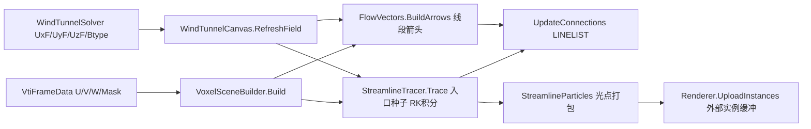

## 产品概述

为风洞 CFD 模拟程序的数据可视化模块新增两种可视化类型，并同步实现到实时模拟程序与离线查看器两处：

1. **矢量图（Vectors）**：用箭头表示流体速度方向，箭头长度∝速度大小、颜色映射速度大小（沿用现有 ScalerPalette LUT），适合分析涡旋、剪切层等复杂流动结构。样式为线段箭头：主干线段 + V 形箭头头部（每矢量 3 段折线），走现成 LINELIST 通道。
2. **流线图（Pathlines）**：显示流体质点运动轨迹，适合稳态流动分析。由入口面（Btype=2 入口前一层流体格点）均匀采样注入种子点，CPU 侧 RK 积分（三线性插值速度场）生成静态流线折线；折线上叠加沿线运动的光点动画粒子（走 FluidBox 同款 UploadInstances 外部实例缓冲通道）。不提供瞬时速度信息（粒子等速光点，不映射速度颜色）。

## 核心功能

- 实时程序（WindTunnelBox/WindTunnelCanvas + FormWindTunnel）：新增 Vectors/Pathlines 开关、矢量采样步长、流线种子密度与最大积分步数等参数控件，切换后触发 RefreshField 重建
- 离线查看器（CDFDxCanvas/VoxelSceneBuilder + CFDCanvas）：VoxelViewOptions 新增对应选项，Build 内新增 BuildVectors/BuildPathlines Pass，UI 同步加开关
- 两处均支持：矢量图与流线图可独立开关、可与现有切片（SliceVisible）/色标条叠加共用；仅绘制流体格点（CellFluid=0），固体/出入口不参与
- 动画粒子：两处均实现，实时程序随渲染节拍推进，离线查看器用 WinForms Timer 推进（数据静态）
- 流线总段数设预算上限（几十万段量级），超限截断，防止 LINELIST 全量重建通道过载

## 技术栈

- 语言/框架：VB.NET WinForms（沿用现有四个工程：WindTunnelBox、CDFDxCanvas、DXApi、DxCanvas，不新增工程引用）
- 渲染：DxScene3DCanvas 现有 LINELIST（LineVertex{X,Y,Z,R,G,B,A}）+ 外部实例缓冲（Direct3D11SceneRenderer.EnsureInstanceCapacity/UploadInstances/DrawPointInstances）
- 共享逻辑落点：CDFDxCanvas.Rendering（WindTunnelBox 已引用 CDFDxCanvas，CDFDxCanvas 已引用 DxCanvas/DXApi，依赖方向合法）

## 实现方案

### 架构设计



### 关键决策

1. **共享构建器放在 CDFDxCanvas.Rendering**：两个调用方的输入同构（Single() 速度分量数组 + 活动掩膜 + 维度/间距/原点），抽成 `FlowVectors.BuildArrows(...)` 与 `StreamlineTracer.Trace(...)` 纯函数式构建器，两处复用、一次实现，符合 DRY；不引入渲染器策略接口（现有项目模式就是 Pass 代码 + 属性开关，遵循现有惯例）
2. **矢量图**：主干 + V 形头（3 段/矢量），长度 = clamp(speed/speedMax)×maxLen（默认 1.7 格间距），颜色取现有 256 级 m_lut/HTML 颜色；按 VectorStride 采样 + SliceVisible 切片过滤；预计段数 = 矢量数×3，默认步长下控制在数万段，LINELIST 全量重建可承受
3. **流线图**：种子 = 入口格点（Btype=CellInlet=2）上游相邻流体层均匀采样（SeedStride 可调）；RK2 中点法 + 三线性插值，步长 = 0.5 格间距，MaxSteps 上限；进入固体/出域/速度低于阈值即终止；输出折线顶点序列，拆 LineSegment 走 UpdateConnections；同时记录折线累计弧长供粒子动画使用
4. **动画粒子**：参照 FluidBox FluidSceneCanvas 模式——粒子不进 Scene（避免 Version++ 触发全量 GPU 缓存重建），每帧按相位沿折线推进光点位置，打包 Single() 后经 `Renderer.UploadInstances` 上传；实时程序用画布渲染节拍，离线用 WinForms Timer；粒子数 = 流线数×每线粒子数（默认 3~5），量级数千，逐帧上传开销小
5. **性能与容错**：流线追踪用全限定 `System.Threading.Tasks.Parallel` 并行（VB 陷阱：避免解析到 Microsoft.VisualBasic.Parallel）；段数预算超限截断并记日志；EnsureMoments 回读仅在需要时调用一次

### 执行注意事项

- 实现前需读 `Direct3D11SceneRenderer.vb` 确认 UploadInstances 的浮点布局（参照 FluidBox `SpeedHeatMapper.FloatsPerPoint` 的打包格式），以及 `DrawPointInstances` 的触发条件/实例点形状
- WindTunnelCanvas 现有 `m_buf` 点云缓冲复用模式、PointSlice 枚举器避免 LOH 分配的写法应沿用到新 Pass
- 粒子动画需要每帧 RequestRender；确认 DxScene3DCanvas 的渲染循环形态后选择 Timer 挂接点
- 构建验证用 G:\Moira\assembly\bin\ 产物（bin\Debug 为过期残留）
- 不改动 DXApi/DxCanvas 渲染核心（无新拓扑需求），爆炸半径限于 CDFDxCanvas 与 WindTunnelBox 两工程

### 目录结构

```
g:\Moira\src\CDFDxCanvas\
├── Rendering\
│   ├── FlowVectors.vb          # [NEW] 矢量箭头构建器：VectorArrowOptions（步长/最大长度/速度上限/LUT）+ BuildArrows(ux(),uy(),uz(),mask,dims,spacing,origin) As LineSegment()，主干+V形头 3 段/矢量，切片与 Btype 过滤由调用方掩膜传入
│   ├── Streamlines.vb          # [NEW] StreamlineOptions（种子步长/步长/MaxSteps/段数预算）+ StreamlineTracer.Trace(...)：入口层种子、RK2+三线性插值、输出折线与累计弧长；StreamlineParticles：相位推进 + 打包 Single() 供 UploadInstances
│   └── VoxelSceneBuilder.vb    # [MODIFY] VoxelViewOptions 增 ShowVectors/ShowPathlines/VectorStride/SeedStride 等；Build 增 BuildVectors/BuildPathlines 私有 Pass，接入 VoxelSceneResult.Lines
├── CFDCanvas.vb                # [MODIFY] 新增可视化开关属性与 RebuildScene 接线；粒子动画 Timer 与 UploadInstances 接入
└── CFDCanvas.Designer.vb       # [MODIFY] 新增矢量/流线复选框与参数控件
g:\Moira\src\WindTunnelBox\
├── Rendering\WindTunnelCanvas.vb  # [MODIFY] 新增 ShowVectors/ShowPathlines 等属性；RefreshField 增矢量 Pass 与流线 Pass；粒子 Timer + EnsureInstanceCapacity/UploadInstances 接入；色标条/切片联动
└── FormWindTunnel.vb (+Designer)  # [MODIFY] 新增 Vectors/Pathlines 复选框、步长/种子密度控件与事件处理（参照 OnArrowsChanged 模式）
```

### 关键代码结构

```
' 共享构建器入参契约（两调用方均能提供）
Public Interface IFlowFieldData
    ReadOnly Property Nx As Integer
    ReadOnly Property Ny As Integer
    ReadOnly Property Nz As Integer
    ReadOnly Property Spacing As Single          ' 各向同性格距（离线侧用 CfdDataset.Spacing）
    ReadOnly Property OriginX As Single          ' 世界坐标原点（离线侧 CfdDataset.Origin）
    ReadOnly Property OriginY As Single
    ReadOnly Property OriginZ As Single
    Function UxAt(idx As Integer) As Single      ' 宿主数组直读：UxF.Data / frame.U
    Function UyAt(idx As Integer) As Single
    Function UzAt(idx As Integer) As Single
    Function IsActive(idx As Integer) As Boolean ' WindTunnel: btype=CellFluid；离线: frame.Mask(idx)
End Interface
' 索引布局：idx = i*(Ny*Nz) + j*Nz + k（与 WindTunnelSolver/UxF 一致）
' 粒子实例输出：Single() 打包为 [x, y, z, heat, r, g, b, a]（实现时以 Direct3D11SceneRenderer 实际布局为准）
```