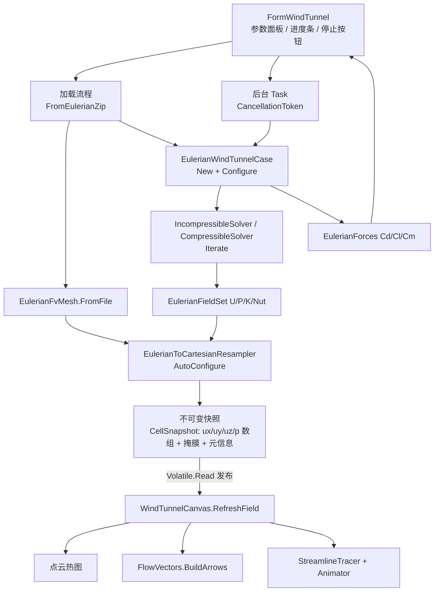

## 产品概述

把 `src\WindTunnelBox` 这个风洞测试模拟器窗体应用的计算引擎，从基于体素模型的 LBM 算法整体替换为已完成开发的、基于 Eulerian 网格模型的 FVM 算法引擎，并使其成为一个可日常使用的生产工具。

## 核心功能

- **网格包加载**：只接收由 `src\EulerianMesh` 命令行工具预生成的 `*.eulerian.zip` 网格包；加载后展示网格质量诊断（单元数、面数、体积、非正交角、patch 表），不再支持 3D 模型现场体素化与 `.voxel.zip` 体素包。
- **FVM 风洞求解**：基于 Eulerian 非结构网格执行不可压（SIMPLE/PIMPLE + Rhie-Chow）与可压缩（AUSM+/HLLC）风洞仿真，支持层流、k-ε、k-ω SST 三种湍流模型，热点可下放 GPU（float32，无 CUDA 时自动回落 CPU）。
- **后台求解与进度控制**：求解在后台线程运行，界面保持响应；显示总步数进度条、实时残差、连续性误差与气动力系数（Cd/Cl/Cm），可随时停止与继续，可单步执行，可重置重算。
- **实时三维可视化**：用笛卡尔重采样把非结构单元解映射回结构网格，沿用现有点云热图、矢量箭头与流线动画三种可视化模式，保留截面剖切、透明阈值、调色板切换等交互。
- **参数面板**：提供来流速度、来流方向、密度、运动粘度、湍流模型与湍流强度、总步数、压力迭代上限、松弛因子、参考面积/长度、可压缩开关与马赫数、通量格式等 FVM 物理参数。
- **彻底移除 LBM**：删除 `Moira.LBMEngine` 项目引用与全部调用点，窗体标题与注释改为 FVM。

## 视觉与交互效果

界面布局保持现有风格（左侧/顶部参数区 + 中央三维画布 + 底部状态栏），中央画布仍为 Direct3D 11 立方体点云场景；新增进度条与停止按钮，状态栏实时显示步数、残差、连续性误差与 Cd/Cl/Cm。加载网格后画布按重采样笛卡尔格渲染速度场/压力场热图，矢量与流线在流体区域内绘制。

## 技术栈

- **语言/框架**：VB.NET，`net10.0-windows`，WinForms + WPF 混合（`UseWindowsForms` + `UseWPF`），SDK 风格 `vbproj`
- **求解引擎**：`Moira.FVMEngine.Eulerian`（根命名空间 `Moira.FVMEngine` + `Namespace Eulerian`）——`EulerianWindTunnelCase` / `EulerianWindTunnelOptions` / `EulerianFvMesh` / `EulerianFieldSet` / `IncompressibleSolver` / `EulerianForces`
- **网格数据**：`Moira.CFDEngine.Eulerian.EulerianMesh` + `EulerianMeshPackage`（zip 读写）
- **渲染**：`Microsoft.VisualBasic.Drawing.DirectX.Scene3D.DxScene3DCanvas` + `Direct3D11SceneRenderer`；`Moira.CDFDxCanvas.Rendering`（`IFlowFieldData`、`FlowVectors.BuildArrows`、`StreamlineTracer`/`StreamlineSet`/`StreamlineAnimator`、`ColorbarOverlay`）
- **并发**：`System.Threading.Tasks.Task` + `CancellationTokenSource` + `IProgress(Of T)` / `SynchronizationContext`（项目已启用 WPF，可用 `Dispatcher`；亦可沿用 WinForms 的 `Control.Invoke`）
- **计算后端**：`EulerianFvmCompute.TryRegister()`（CUDA float32 CSR）+ `TensorF`/`SIMD`（CPU double）

## 实施方案

### 总体策略

不改 FVM 引擎本身，只在 `src\WindTunnelBox` 内做「换引擎接线」。核心是补上两层适配：

1. **数据适配层**：`EulerianToCartesianResampler` 把非结构单元解重采样为结构笛卡尔格 + 域外掩膜，补齐 `IFlowFieldData` 的结构化契约，使现有点云/矢量/流线管线零改造复用。
2. **并发适配层**：不可变快照 + 后台 Task 发布、UI 线程渲染，配合 `CancellationToken` 实现停止/继续。

### 关键决策与理由

1. **只支持 `*.eulerian.zip`**：网格生成（八叉树/切割单元、patch 分类）耗时数秒到数十秒且内存占用大，放在命令行预生成、GUI 只做加载，是生产环境的正确分工；同时消除 LBM 时代「现场体素化」的不确定性与分辨率天花板。
2. **重采样回笛卡尔格而非按单元中心渲染**：`IFlowFieldData` 与三套可视化管线（点云 stride 降采样、矢量箭头、流线 RK2 三线性插值）全部建立在 `i/j/k` 线性下标之上；按单元中心渲染需重写矢量与流线的邻接/插值逻辑，风险与工作量都远大于重采样。重采样器已完成且内部有分箱索引（`_binIndex`）可复用，`AutoConfigure` 能按包围盒自动定分辨率。
3. **后台 Task + 不可变快照**：FVM 单次外迭代含动量预测 + 压力 Poisson + 场校正，比 LBM 一步贵 1~2 个量级，同步跑必然卡死 30ms 定时器。采用「后台线程算 → 生成不可变快照 → 原子发布 → UI 线程取快照渲染」，既保证 UI 响应，又避免渲染线程读到半更新的场数组。
4. **重采样分辨率上限**：`AutoConfigure(maxCells:=…)` 控制在 20 万~40 万格点以内（默认取 256³ 上限内的自适应值），保证每帧重采样耗时在几十毫秒量级；重采样器构造一次、逐帧复用（内部分箱索引不重建）。
5. **固体/域外掩膜**：Eulerian 网格只含流体域，`NearestCell(x,y,z) = -1` 的笛卡尔格点即「域外」，用以替代原 `CudaLbmBackend.CellSolid`，渲染为固定灰 `#94A3B8`，并作为 `IsActive`/`IsSeedable` 的依据。
6. **世界坐标映射**：原管道用「格点下标 + 质心补偿」当世界坐标；改为 `Origin + i * Spacing` 后需同步调整 `PointCloudPoint` 写入、质心补偿（改为按 Spacing 缩放后的中心化）与背景网格尺寸，避免场景中模型比例失真。
7. **压力语义**：LBM 的 `(rho-1)/3` 格子压力改为直接读 FVM 的 `p` 场（Pa 量级，SIMPLE 下可差一个常数），色标按当前帧 min/max 自适应（现有 Pass1 值域统计逻辑已具备）。

### 架构设计



### 数据流

1. 用户选择 `*.eulerian.zip` → `EulerianFvMesh.FromFile` → 显示 `Diagnostics`
2. 构造重采样器（`New EulerianToCartesianResampler(mesh.Mesh)` + `AutoConfigure`）→ 得到 `Nx/Ny/Nz/Spacing/Origin`
3. 按 UI 参数构造 `EulerianWindTunnelOptions` → `New EulerianWindTunnelCase(mesh, opts)` → `Configure()`
4. 启动后台 Task：循环 `case.Run(1, ...)` 或逐次 `Iterate()`，每次迭代前检查取消；每 N 步用重采样器生成 `CellSnapshot` 并发布
5. UI 定时器（30ms）取最新快照 → `RefreshField()` → 点云/矢量/流线 → `RequestRender()`；同时刷新进度条与状态栏

### 性能要点

- **热路径**：`Resample` 为 O(Nx·Ny·Nz)，每帧一次；通过 `maxCells` 上限与「仅在采样间隔到点时重采样」控制
- **避免**：不要在渲染线程调用 `EnsureMoments` 之类会触发设备同步的操作；不要每帧重建重采样器或 LUT
- **显存/内存**：重采样后 4 个 `Single()` 数组（ux/uy/uz/p）+ 1 个掩膜，40 万格点约 8 MB，可接受
- **取消粒度**：每次外迭代前 `ThrowIfCancellationRequested`，保证停止响应在单次迭代耗时内

## 实施注意事项

- **零回归红线**：不得修改 `src\FVMEngine\Eulerian\*` 的既有行为（已通过 45/45 自测）；若确需扩展（如暴露 `EulerianFvMesh.Mesh`、给 `EulerianWindTunnelCase` 增加只读的当前连续性残差/残差历史属性），必须是向后兼容的可选新增。
- **引用调整**：`WindTunnelBox.vbproj` 把 `..\LBMEngine\LBMEngine.vbproj` 替换为 `..\FVMEngine\FVMEngine.vbproj`；确认 `ZMesh` 是否仍有引用后再决定是否移除（`WindTunnelSceneBuilder`/`WindTunnelVoxelJson` 在改造后应不再使用）。
- **VB 陷阱**：`Module` 成员不能加 `Shared`；`Parallel` 需全限定；局部变量不得与类型名或类字段仅大小写不同；本文件已用 `Imports Math = System.Math`，沿用；`List(Of T).Count(lambda)` 要用 `.Where().Count()`；控件跨线程访问必须封送。
- **渲染既有事实**：`Designer.FromSchema(palette, 256)` 实际返回 257 项，取顶端色用 `lut(lut.Length - 1)`；`m_backend.ExternalCloudOverlay = True` 需保持；直线流线过滤用 `StreamlineSet.MinCurvature`（`DefaultStraightness = 0.05`），切换时无需重追踪。
- **错误处理**：加载/求解异常消息需含网格文件名、单元数、patch 表、当前步数与最近残差；不要打印大数组；GPU 注册失败需回落 CPU 并在状态栏提示 `EulerianFvmCompute.LastError`。
- **诊断展示**：网格加载后立即输出 `EulerianFvMesh.Diagnostics`（含最大非正交角），便于判断是否会因网格质量导致压力发散（已知压力欠松弛默认 0.3 可抑制）。

## 目录结构

```
Moira/src/WindTunnelBox/
├── WindTunnelBox.vbproj                 # [MODIFY] 删除 LBMEngine 引用(L35)，新增 ..\FVMEngine\FVMEngine.vbproj；
│                                        #   评估后决定是否移除 ZMesh 引用(L36)
├── FormWindTunnel.vb                    # [MODIFY] 主窗体逻辑整体重写：
│                                        #   - 删除 Imports Moira.LBMEngine / DefaultViscosity / m_scene / m_solver
│                                        #   - 字段改为 m_case As EulerianWindTunnelCase、m_mesh As EulerianFvMesh、
│                                        #     m_resampler、m_cts As CancellationTokenSource、m_snapshot
│                                        #   - OpenFileDialog.Filter 改为 *.eulerian.zip
│                                        #   - LoadModel 改为 加载网格 → 诊断 → 重采样器 AutoConfigure → New case + Configure
│                                        #   - RunSteps/OnTimerTick 改为后台 Task 驱动 + 进度发布
│                                        #   - UpdateOverlay 改为显示 步数/残差/连续性误差/Cd/Cl/Cm/求解路径
│                                        #   - OnResetFlow 语义改为重建 case
│                                        #   - SliceMax 改为读重采样器的 Nx/Ny/Nz
│                                        #   - UpdateOverlay 的 LBM 专有量(ComputeMaxSpeed/ComputeMassDrift/
│                                        #     ComputeWakeDeficit) 全部替换
├── FormWindTunnel.Designer.vb           # [MODIFY] 窗体标题改为 FVM；删除/停用 m_cmbVoxelizer、m_numVoxelSize、
│                                        #   m_numResolution；m_numFreestream 改为 m/s 量纲(默认 30)；
│                                        #   新增：密度、运动粘度、湍流模型下拉、湍流强度、总步数、压力迭代上限、
│                                        #   松弛因子、参考面积/长度、可压缩开关+马赫数+通量格式、
│                                        #   ProgressBar 进度条、停止按钮、残差/力系数标签
├── Rendering/
│   ├── WindTunnelCanvas.vb              # [MODIFY] 核心渲染适配：
│   │                                    #   - 删除 Imports Moira.LBMEngine(L10) 与 WindTunnelSolver 类型(L331/L423/L436)
│   │                                    #   - BindSolver(solver) → BindSnapshot(snapshot)（重采样数组 + 掩膜 + 元信息）
│   │                                    #   - RefreshField(L549-811) 数据源改为快照：删除 EnsureMoments(L554)，
│   │                                    #     L557-560 的 RhoF/UxF/UyF/UzF 改为快照数组
│   │                                    #   - CudaLbmBackend.Cell* 判据(L463/584/596/638/649/693) 改为域外掩膜
│   │                                    #   - 世界坐标由「下标+质心补偿」改为 Origin + i*Spacing(L623-625/L646/L669)
│   │                                    #   - ScalarAt(L813-826) 的 Pressure 分支(L819) 改为直接读快照 p 数组
│   │                                    #   - 保持 ExternalCloudOverlay=True(L398)、MaxPoints 降采样(L446-451)、
│   │                                    #     流线/矢量管线(L682-793) 不变
│   └── WindTunnelFlowField.vb            # [MODIFY] 删除 Imports Moira.LBMEngine(L17)；
│                                        #   IsActive(L124-127)/IsSeedable(L130-136) 改用域外掩膜；
│                                        #   Spacing 由 1 改为重采样器的实际 Spacing(L86-102)，Origin 注入保持
└── Simulation/                          # [NEW] 新增并发与快照适配层
    ├── EulerianFieldSnapshot.vb         # [NEW] 不可变快照类型：Nx/Ny/Nz、Origin/Spacing、ux/uy/uz/p(Single())、
    │                                    #   域外掩膜(Byte())、步数、时间、残差、连续性误差、Cd/Cl/Cm、最大速度；
    │                                    #   提供 FromCase(case, resampler) 工厂做重采样与元信息采集
    └── WindTunnelSimulationRunner.vb    # [NEW] 后台求解编排：Task + CancellationTokenSource + IProgress；
                                         #   封装「加载网格包 → 建重采样器 → 建 case → Configure → 循环迭代 →
                                         #   按间隔生成并发布快照 → 结束上报」全流程；暴露 Start/Pause/Stop/StepOnce/
                                         #   Reset 与 IsRunning；GPU 注册与回落提示也在此处处理
```

## 关键代码结构

```
' g:/Moira/src/WindTunnelBox/Simulation/EulerianFieldSnapshot.vb
' 不可变快照：后台线程生成、UI 线程消费，避免渲染读到半更新状态
Public NotInheritable Class EulerianFieldSnapshot
    Public ReadOnly Property Nx As Integer
    Public ReadOnly Property Ny As Integer
    Public ReadOnly Property Nz As Integer
    Public ReadOnly Property OriginX As Double
    Public ReadOnly Property SpacingX As Double   ' Y/Z 同理
    Public ReadOnly Property Ux As Single()       ' 长度 Nx*Ny*Nz，idx = i*Ny*Nz + j*Nz + k
    Public ReadOnly Property Uy As Single()
    Public ReadOnly Property Uz As Single()
    Public ReadOnly Property P As Single()
    Public ReadOnly Property Outside As Byte()    ' 1 = 域外(渲染为固体灰)，0 = 流体
    Public ReadOnly Property StepIndex As Integer
    Public ReadOnly Property Residual As Double
    Public ReadOnly Property ContinuityError As Double
    Public ReadOnly Property Cd As Double
    Public ReadOnly Property Cl As Double
    Public ReadOnly Property Cm As Double
    Public ReadOnly Property MaxSpeed As Double
End Class

' g:/Moira/src/WindTunnelBox/Simulation/WindTunnelSimulationRunner.vb
' 后台求解编排（UI 只与之交互，不直接碰求解器）
Public Function LoadMesh(zipPath As String) As String   ' 返回 EulerianFvMesh.Diagnostics
Public Sub Configure(options As EulerianWindTunnelOptions)
Public Sub Start(steps As Integer)
Public Sub [Stop]()
Public Sub StepOnce()
Public Sub Reset()
Public ReadOnly Property IsRunning As Boolean
Public ReadOnly Property LatestSnapshot As EulerianFieldSnapshot   ' Volatile 发布
Public Event ProgressChanged(percent As Integer, snapshot As EulerianFieldSnapshot)
```

## 验证方式

- `src\WindTunnelBox` 编译 0 错误（重点确认无残留 `Moira.LBMEngine` 引用）
- 用 `src\EulerianMesh` 对 `G:\Microsoft.VisualBasic.Drawing\models\Custom_F1_2022_3D.stl` 生成网格包，在窗体中：加载成功并显示诊断 → 启动后进度条推进、画布出现速度场热图 → 矢量与流线模式可切换 → 停止/继续/单步/重置可用 → 状态栏残差与 Cd 为有限值

## Agent 扩展

### SubAgent

- **code-explorer**
- 用途：改造前复核 `src\WindTunnelBox\Rendering\WindTunnelCanvas.vb`（955 行）中 `RefreshField` L549-811 的完整下标与坐标逻辑、`FormWindTunnel.Designer.vb` 的控件声明与布局容器结构，以及确认 `ZMesh` 引用在移除 LBM 后是否仍被使用，避免臆造控件名与布局层级。
- 预期结果：给出精确的行号级改动清单与可安全删除/新增的控件清单。

### Skill

- **lsp-code-analysis**
- 用途：在实施阶段做语义级导航与影响面分析——确认 `WindTunnelSolver`、`CudaLbmBackend.Cell*`、`WindTunnelSceneBuilder`、`WindTunnelVoxelJson` 在 `src\WindTunnelBox` 内的全部引用点已清空，并验证 `EulerianToCartesianResampler.Resample` / `EulerianWindTunnelCase.Run` 的调用签名与新接线一致。
- 预期结果：产出「定义 → 引用 → 实现」链路清单，确认零残留 LBM 依赖且新调用签名匹配。