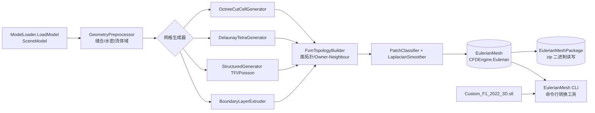

## 产品概述

为 Moira CFD 引擎构建“三维模型 → Eulerian 网格”完整网格生成流水线：加载任意支持的三维模型文件（STL/OBJ/glTF/GLB/DAE/3DS/3MF），经几何预处理后生成 CFD 求解器所需的非结构/结构化体网格，输出 OpenFOAM 风格 FVM 数据模型，并以 zip 二进制压缩包持久化。

## 核心功能

- **几何预处理**：模型加载（`ModelLoader.LoadModel` → `SceneModel.Surfaces`）、容差缝合/水密性检测与修复、包围盒与特征几何提取、流体域（外部风场域）抽取
- **笛卡尔八叉树网格**：包围盒大立方体递归八分，与边界三角面片相交单元继续细分至目标尺度；边界切割单元（cut-cell 多面体）
- **Delaunay 非结构网格**：改进现有 2D Delaunay（Fortune 算法，未充分测试）+ 新写 3D Bowyer-Watson 逐点插入四面体化（空球特性，超四面体初始化）
- **结构化网格**：TFI 超限插值 + Poisson 椭圆方程法
- **边界层层推进**：壁面法向棱柱层网格，含法向碰撞处理
- **FVM 拓扑构建**：面-节点拓扑（排序消除方向性）、Owner/Neighbour 数组、面法向量/面积/单元体积
- **边界 Patch**：按包围盒位置自动推断（Y 地面=Wall、X 极值=Inlet/Outlet 等）+ 用户显式指定覆盖
- **网格质量优化**：Laplacian 平滑（内部节点移向邻域质心，边界节点锁定）
- **持久化**：zip 包（model.json 元数据 + 二进制数组 Deflate 压缩，分块流式读写）的存储与读取
- **命令行工具**（src\EulerianMesh\EulerianMesh.vbproj）：通过命令行参数设置转换参数（网格类型/尺度/Patch 配置/输出路径等），将目标三维模型文件一键转换为 Eulerian 网格模型；并以 `G:\Microsoft.VisualBasic.Drawing\models\Custom_F1_2022_3D.stl`（F1 赛车模型，约 45.9 MB）作为真实大模型调试用例

## 技术栈

- 语言：VB.NET（与 Moira / sciBASIC# 全系一致），net10.0
- 底层框架：sciBASIC#（Core、imaging.NET5、Landscape、Math.NET5、TensorFlow、ILCuda/ILCudaTensor）
- 张量计算：`TensorF`（float32，索引器纯数组读写，避免 Double 版 Tensor 的原子计数开销）；`computeKernelF` 可插拔后端，默认 SIMDTensorF（`Microsoft.VisualBasic.Core\src\Math\SIMD`），可切换 CUDA GPU 加速
- 存储：`System.IO.Compression.ZipArchive` + `System.Text.Json`（参照 `src\CFDEngine\Snapshot\VoxelPackage.vb` 的 Writer/Reader 分块流式模式）

## 实现方案

1. **分层架构**：底层库（八叉树、Delaunay）→ 网格生成层（ZMesh\Eulerian）→ 数据模型与 IO 层（CFDEngine\Eulerian）→ 命令行工具与自测工程。每层只依赖下层，ZMesh.vbproj 与 EulerianMesh.vbproj 已引用全部所需工程，无需改动引用。
2. **八叉树**（Core\ComponentModel\DataStructures）：通用 `Octree`（Point3D 空间划分，节点容量+最大深度，Insert/Query 邻域/遍历）+ `TightOctree`（笛卡尔网格专用：携带三角面片索引，与包围盒相交的叶子单元递归八分至目标尺度，输出叶子单元列表供切割单元法使用）。面向 `Vector3D`/`Point3D` 通用接口，避免绑定网格细节。
3. **2D Delaunay 改进**：现有 Voronoi.vb 为 Fortune 算法移植（as3delaunay 风格）。补充边界情形修复（重复点、共线/退化外接圆、点落在边界矩形外）、插入点完备性测试，修正后供 Delaunay 网格生成器的表面三角形生成复用。
4. **3D Delaunay**（Math3D\Delaunay3D\）：Bowyer-Watson 逐点插入，超四面体初始化，空球判定（行列式 inSphere 测试），坏四面体并集空腔+面重连；用第 1 步的 Octree 做点定位加速（O(n·log n) 平均）；输出 `Tetrahedron` 列表供 FVM 拓扑构建。
5. **FVM 数据模型**（CFDEngine\Eulerian）：`EulerianMesh` class——`Points`（Single 三元组）、`Faces`（点索引表+Owner/Neighbour，边界面 Neighbour=-1）、`Owner()/Neighbour()` 数组、`Patches` 字典（Patch 名→面索引集合）、预计算的面法向量/面积/单元体积；`EulerianMeshPackage` Writer/Reader 仿 VoxelPackage（model.json 元数据 + model.points/model.faces/model.owner 等二进制条目 Deflate 压缩、分块流式）。
6. **四类网格生成器**（ZMesh\Eulerian）：统一 `IMeshGenerator` 接口产出中间 `RawCellMesh`，由共享的 `FvmTopologyBuilder` 转为 EulerianMesh；`PatchClassifier` 自动推断+用户配置覆盖；`LaplacianSmoother` 内部节点平滑。热点计算（Poisson 迭代、距离场）用 TensorF 编写以支持 GPU 后端。
7. **命令行工具**（src\EulerianMesh\Program.vb，项目骨架已存在且已引用 CFDEngine/ZMesh）：命令行接口——`EulerianMesh --input <模型文件> --output <输出zip> --type octree|delaunay|structured [--resolution <尺度>] [--domain-scale <n>] [--patch <名:类型> ...] [--gpu]` 等；封装 EulerianPipeline 一键转换；需为该项目补齐 assembly\bin 输出路径配置。调试用例：`G:\Microsoft.VisualBasic.Drawing\models\Custom_F1_2022_3D.stl`（大型 STL，验证大模型加载、预处理耗时、网格生成规模与 zip 写出）。
8. **性能**：八叉树细分 O(n·log n)；inSphere/点定位用八叉树索引；Poisson 迭代为带宽受限算子，TensorF 无原子索引器，SIMD AVX2 8 lane；大网格 zip 分块流式写避免 OOM。

## 系统架构



## 目录结构

```
G:\GCModeller\src\runtime\sciBASIC#\Microsoft.VisualBasic.Core\src\ComponentModel\DataStructures\
├── Octree.vb                     # [NEW] 通用八叉树：节点容量/最大深度、Insert/Query/遍历、包围盒相交
├── TightOctree.vb                # [NEW] 笛卡尔网格专用紧八叉树：三角面片索引+相交细分+叶子单元枚举
G:\GCModeller\src\runtime\sciBASIC#\gr\Microsoft.VisualBasic.Imaging\Drawing2D\Math2D\Voronoi\Delaunay\
├── Voronoi.vb                    # [MODIFY] 2D Delaunay 修复：退化/重复点/越界边界情形 + 数值健壮性
G:\GCModeller\src\runtime\sciBASIC#\gr\Microsoft.VisualBasic.Imaging\Drawing3D\Math3D\
└── Delaunay3D\
    ├── Tetrahedron.vb            # [NEW] 四面体：顶点/外接球/insphere 判定
    ├── DelaunayTriangulation3D.vb# [NEW] Bowyer-Watson：超四面体、空腔重构、八叉树点定位
    └── DelaunayTestHelper.vb     # [NEW] 质量度量（半径比等）与自检
g:\Moira\src\CFDEngine\Eulerian\
├── EulerianMesh.vb               # [NEW] FVM 网格数据模型 class：Points/Faces/Owner/Neighbour/Patches/几何量
├── EulerianPatch.vb              # [NEW] Patch 定义与类型枚举（Wall/Inlet/Outlet/Symmetry）
└── EulerianMeshPackage.vb        # [NEW] zip 包 Writer/Reader：model.json + Deflate 二进制分块流式
g:\Moira\src\ZMesh\Eulerian\
├── GeometryPreprocessor.vb       # [NEW] 场景装配/容差缝合/水密性检测/流体域包围盒抽取
├── MeshGenerators\
│   ├── IMeshGenerator.vb         # [NEW] 网格生成器统一接口 + RawCellMesh 中间模型
│   ├── OctreeCutCellGenerator.vb # [NEW] 笛卡尔八叉树细分 + 平面切割单元多面体
│   ├── DelaunayTetraGenerator.vb # [NEW] 表面三角化(2D Delaunay) + 3D Delaunay 四面体填充
│   ├── StructuredMeshGenerator.vb# [NEW] TFI 超限插值 + Poisson 椭圆方程（TensorF 迭代）
│   └── BoundaryLayerExtruder.vb  # [NEW] 壁面法向棱柱层推进 + 法向碰撞处理
├── FvmTopologyBuilder.vb         # [NEW] 面-节点拓扑/Owner-Neighbour/几何量预计算
├── PatchClassifier.vb            # [NEW] 包围盒自动推断 + 用户显式指定覆盖
├── LaplacianSmoother.vb          # [NEW] 内部节点平滑（边界锁定）
└── EulerianPipeline.vb           # [NEW] 一键流水线入口：LoadModel → 预处理 → 生成 → 拓扑 → 存储
g:\Moira\src\EulerianMesh\
├── EulerianMesh.vbproj           # [MODIFY] 已存在：补充 assembly\bin 输出路径等配置
└── Program.vb                    # [MODIFY] 命令行工具：参数解析 → EulerianPipeline 转换 → 输出 zip
g:\Moira\test\ZMeshEulerianSelfTest\
└── Program.vb                    # [NEW] 自测：八叉树/Delaunay2D/3D/TFI/拓扑正确性/zip 回读断言
```

## 实施要点

- VB 陷阱：Module 成员不能标 Shared；参数名不能用 `set`；局部变量不能与类型名仅大小写不同；`Parallel` 需全限定 `System.Threading.Tasks.Parallel`
- 编译顺序：Core → imaging → Landscape/TensorFlow → CFDEngine → ZMesh → EulerianMesh CLI → 自测工程；产物部署到 G:\Moira\assembly\bin（含 runtimeconfig.json + deps.json）
- 基础库（Core/imaging）为跨项目共享代码，改动仅限新增文件与最小化修复，保持向后兼容
- F1 调试用例为大模型（45.9 MB STL）：调试时先用低分辨率/小 domain-scale 验证全流程，再逐步提高分辨率；关注内存峰值与生成耗时