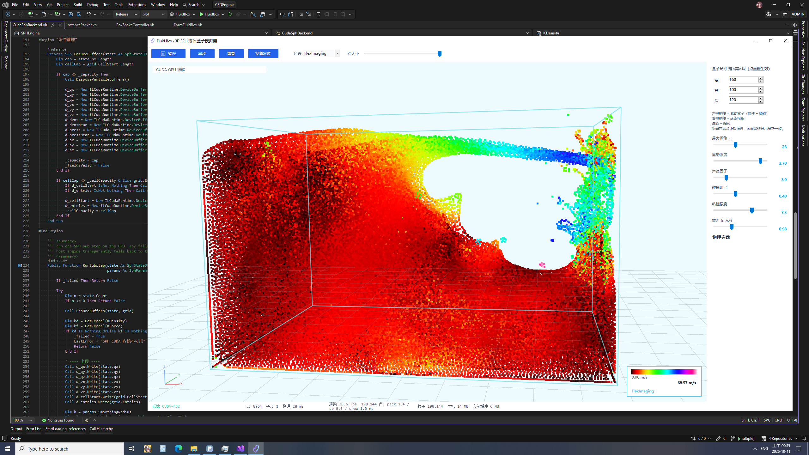
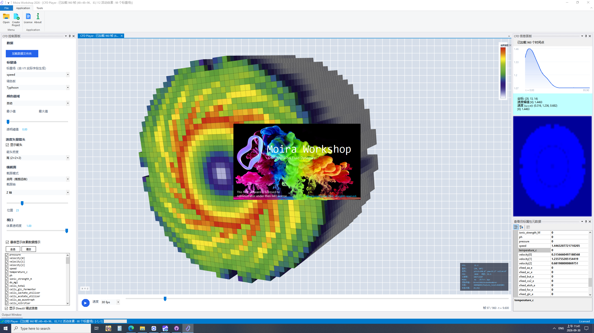

# Moira Workshop

Computational fluid dynamics (CFD) is a branch of fluid mechanics that uses numerical analysis and data structures to analyze and solve problems that involve fluid flows. Computers are used to perform the calculations required to simulate the free-stream flow of the fluid, and the interaction of the fluid (liquids and gases) with surfaces defined by boundary conditions. With high-speed supercomputers, better solutions can be achieved, and are often required to solve the largest and most complex problems. Ongoing research yields software that improves the accuracy and speed of complex simulation scenarios such as transonic or turbulent flows. Initial validation of such software is typically performed using experimental apparatus such as wind tunnels. In addition, previously performed analytical or empirical analysis of a particular problem can be used for comparison. A final validation is often performed using full-scale testing, such as flight tests.

CFD is applied to a wide range of research and engineering problems in many fields of study and industries, including aerodynamics and aerospace analysis, hypersonics, weather simulation, natural science and environmental engineering, industrial system design and analysis, biological engineering, fluid flows and heat transfer, engine and combustion analysis, and visual effects for film and games.

+ View [help page](vignettes/index.html)
+ Play [a online version](docs/html/index.html) (original source link [https://physics.weber.edu/schroeder/fluids/](https://physics.weber.edu/schroeder/fluids/))
