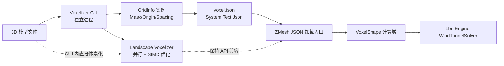

## 产品概述

解决高分辨率模型体素化耗时过长的问题，交付两条能力：

### 1. 独立体素化命令行工具（Voxelizer CLI）

- 在 `g:/Moira/src/Voxelizer`（现为 Hello World 骨架）中实现完整的体素化命令行程序
- 支持任意 Landscape 可加载的 3D 模型文件（STL/OBJ/glTF/GLB/COLLADA/3DS/3MF），按命令行参数（分辨率或物理体素尺寸、体素化器类型 Standard/Sdf/Physical/SdfRaw、亚采样数等）执行体素化
- 体素化完成后将结果构建为 `CFDEngine.Snapshot.JSON.GridInfo`（Data.vb:5-36）对象实例，用 System.Text.Json 序列化导出为 json 文件（紧凑输出，Mask 大数组不缩进）
- WindTunnelBox 支持直接读取该体素模型 json 做模拟计算，将体素化从 GUI 启动路径中移除（预体素化工作流）

### 2. Landscape 体素化算法性能优化

- `Voxelizer.VoxelizeTriangles` 列扫描算法：消除「每列遍历全部三角形」的 O(列数×三角形数) 热点
- 采用 Parallel 并行列处理 + 核心 SIMD 库（Microsoft.VisualBasic.Core/src/Math/SIMD）向量化加速
- SDFVoxelizer 并行计算完整性复查
- 优化后保持两个 Voxelize 入口 API 签名与体素化结果语义不变（向后兼容 ZMesh/WindTunnelBox 既有调用）

### 验收标准

- CLI 可独立完成「模型文件 → 体素化 → GridInfo JSON 导出」全流程
- WindTunnelBox 加载导出的 json 后构建的风洞计算域与在 GUI 内直接体素化一致
- 同参数同模型下 Standard 路径体素化相对优化前有明显加速（预期一个数量级以上），高分辨率（≥96）可用
- 优化前后固体体素数一致或差异可解释（浮点求交顺序变化导致的边界格点差异）

## 技术栈

- 语言/运行时：VB.NET，net10.0（与现有一致）
- 体素化：Landscape Voxelization 模块（修改）；加载走 ModelLoader
- JSON：System.Text.Json（复用 `SnapshotMetadata.ToJson()` 的紧凑序列化范式）
- 并行/SIMD：System.Threading.Tasks.Parallel、sciBASIC `Microsoft.VisualBasic.Math.SIMD`（SimdExtensions/Vec* 系列）与 `System.Numerics.Vector(Of Double)`
- 类型复用：`GridInfo`（CFDEngine.Snapshot.JSON）、`VoxelModelLoader.FromVoxelArray`、`WindTunnelSceneBuilder.ToCfdVoxelModel` 范式

## 实现方案

### 1. Landscape Voxelizer 性能优化（g:/GCModeller/.../Voxelization/Voxelizer.vb）

**热点分析**：`VoxelizeTriangles(:357-433)` 对每个 (x,y) 列遍历全部三角形做 Möller–Trumbore 求交，单线程，且每条射线重复计算三角形常量（edge1/edge2/h/a，:293-300）。实测 city_seed42.stl @ resolution=40 约 26 s。

**优化措施**（保持 API 与输出语义不变）：

1. **三角形常量预计算（SoA 化）**：新增内部预处理，将三角形展平为平行数组（v0x/y/z、e1x/y/z、e2x/y/z）。因射线方向固定为 (0,0,1)，预计算 h = (-e2y, e2x, 0)、a = e1·h、f = 1/a，并过滤 |a|<ε 的退化三角形。每对（射线，三角形）的求交化简为：u = f·(sx·hx + sy·hy)、qz = sx·e1y − sy·e1x、v = f·qz、t = f·(e2·q)——纯标量乘加，无三角函数/对象分配
2. **XY 空间分箱**：按三角形 XY 包围盒落入的体素列区间建桶（每列只测桶内三角形），消除绝大多数无效求交；高分辨率下单个三角形只覆盖极少列，收益随分辨率提升
3. **Parallel.For 列并行**：外层 x 循环改 Parallel.For，交点列表、排序、MergeClose 全部线程局部化（原 `intersections` 复用列表移入循环体）；各列写 shape 的索引区间不相交，无锁
4. **SIMD 向量化**：列内对桶中三角形按 `Vector(Of Double)` 宽度分批（SoA 数组批量计算 sx/sy/sz、u、v、t 与掩码判定，标量处理尾部）；包围盒计算改用 SoA + sciBASIC SIMD 归约（VecMin/VecMax）
5. 分箱数据结构与批处理在 x 方向按行划分，避免巨型桶数组内存峰值

### 2. SDFVoxelizer 复查

- 复查 `Parallel.For(:231)` 的并行完整性（SDF/Occupancy 写索引唯一性、共享只读数据访问），必要时修复；BVH 构建如为单线程热点则评估并行化收益后决定（避免过度设计）

### 3. Voxelizer CLI（g:/Moira/src/Voxelizer）

- `Program.vb`：参数解析（`--in 模型文件`、`--out json路径`、`--resolution N` 或 `--voxel-size F`、`--voxelizer standard|sdf|physical|sdfraw`、`--subsamples N`、`--sdf-resolution N`、`--help`），无参数时打印用法
- 流程：`ModelLoader.LoadModel`（3MF 走专用路径）→ 按所选体素化器与尺寸/分辨率参数体素化 → 语义反转构建 `GridInfo`（Landscape True=固体 → Mask 0；流体 → Mask 1；Origin=[MinX,MinY,MinZ]；Spacing=[voxelSize×3]；Nx/Width 等双向填充；IndexOrder 注明 `i*ny*nz + j*nz + k`）→ `JsonSerializer.Serialize`（WriteIndented=False）落盘
- `Voxelizer.vbproj`：新增对 `g:/Moira/src/CFDEngine/CFDEngine.vbproj` 的 ProjectReference（复用 GridInfo，避免 DTO 漂移）
- 控制台输出各阶段耗时（加载/体素化/导出）与统计（维度、固体数），便于基准对比

### 4. WindTunnelBox 消费端接入

- ZMesh 新增体素 JSON 加载入口（与 WindTunnelSceneBuilder 同层，复用其语义反转/BuildDomain 范式）：读取 GridInfo JSON → Mask(0=固体) 反转回整数数组 → `VoxelModelLoader.FromVoxelArray(solidValue:=1)` → VoxelShape → 组装 WindTunnelScene（Origin/Spacing 记录进场景元数据）
- `FormWindTunnel`：OpenFileDialog 过滤器加入 `*.json`；按扩展名分派「模型体素化」或「体素 json 直载」；demo 自动加载逻辑优先探测 `city_seed42.voxel.json`（存在则直载，跳过 26s 体素化）

## 架构图

## 实施要点

- **向后兼容**：Voxelizer 两个 Voxelize 公共 API 签名不变；WindTunnelBox GUI 内体素化路径保留（json 直载为增量）
- **正确性锚点**：优化前后用 /voxel 对比同参数固体体素数（浮点求交批处理顺序差异导致的边界格点 ±微量差异可接受，需在输出中说明）
- **性能验证**：CLI 输出各阶段耗时；以 resolution=40/96 两档对比优化前后
- **爆炸半径**：sciBASIC 属核心库，只改 Voxelization 模块内部实现，不触碰其他模块；CLI 与 GUI 的 JSON 契约以 GridInfo 为准单一来源

## Agent Extensions

### SubAgent

- **code-explorer**
- Purpose: 实现前精读 sciBASIC SIMD 库（SimdExtensions/Vectorized/Intrinsics 的确切 API 与用法约定）、BVH.vb 结构、SDFVoxelizer 并行段、ModelLoader/3MF 加载路径与 VoxelModelLoader.FromVoxelArray 签名，确保 CLI 与优化实现与核心库约定完全对齐
- Expected outcome: 产出 SIMD 调用范式、BVH/并行现状结论与 CLI 加载路径的精确约定，避免实现期返工