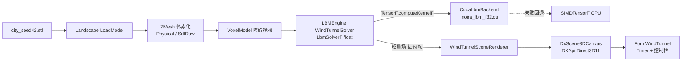

## 用户需求

在工作区 `g:/Moira/src` 中，以 LBMEngine（D3Q19 格子 Boltzmann CFD 引擎）为计算核心，构建一个基于 DirectX 实时渲染的风洞测试模拟器。

## 需求分解（含已确认的澄清结果）

### 1. LBMEngine 混合精度性能优化（前置任务）

- 评估计算热点：平衡态计算、BGK/TRT/MRT 碰撞、流传播（18 方向 Shift）、矩量计算均为全张量热点。
- 新增基于 **float 精度 TensorF** 的 LBM 求解路径：碰撞/流动/平衡态全部 float 化。
- CUDA 后端可用时走 GPU（新增 LBM 专用 .cu 内核），失败自动回退 CPU SIMD（SIMDTensorF）。
- 原 Double 版 `LbmSolver` 保留作为基准校验。

### 2. 风洞边界条件扩展

- `LbmSolver` 目前是封闭方腔顶盖驱动，需扩展/新增支持：
- 体素障碍 halfway bounce-back（掩膜注入接口）；
- 定常来流入口（x=0 速度边界）；
- 零梯度出流（出口）；
- 地面/顶面滑移或无滑移；
- 参考 `CFDEngine/WindTunnel.vb` 的接口设计。

### 3. ZMesh 原始精度体素化（两条新路径，由 VoxelizerKind 枚举切换）

- **物理尺寸直接体素化**：绕开 `resolution` 限制，按用户指定物理体素尺寸（或由模型特征尺寸自动推导）调用 Landscape 现有 `voxelSize` 重载。
- **SDF 连续采样**：基于 `SDFVolume` 连续场（带符号距离 + 亚体素占用率），CFD 网格可独立于体素化分辨率任意采样，实现真正的连续精度。

### 4. WindTunnelBox 风洞模拟器（实时渲染）

- `FormWindTunnel.vb`（当前空壳）内嵌 `DxScene3DCanvas` 3D 画布，参照 CDFDxCanvas 的实现模式。
- 实时渲染内容：障碍体素立方体、速度场点云/切片、速度箭头、色标。
- 定时器驱动逐帧步进模拟，带控制栏（启动/暂停/步进、CUDA 开关、切片控制、统计信息）。
- Demo：通过 Landscape 加载 `ZMesh/CityBlender/samples/city_seed42.stl`（已确认存在，4.88 MB）。

## 验收标准

- float 求解器与 Double 基准结果一致性可验证；CUDA 开启后有明显加速且失败时自动回退 CPU。
- 体素化在极小 voxelSize / 高分辨率采样下不再产生粗糙模型。
- FormWindTunnel 可加载 city_seed42.stl，实时看到绕建筑物的风流场演化。

## 技术栈

- 语言/运行时：VB.NET，net10.0 / net10.0-windows（与现有项目一致）。
- 计算栈：sciBASIC# TensorFlow（Tensor/TensorF）、ILCuda + ILCudaTensor（CUDA float32）、CFDEngine（CudaTensorF 参考实现 + TensorGrid）。
- 3D 管线：Landscape（STL/3MF 加载 + 体素化）、DXApi + DxCanvas（Direct3D11 场景渲染）、CDFDxCanvas（可视化参考与复用）。

## 实现方案

### 阶段一：LBMEngine 混合精度

**热点评估结论**（已探明）：`LbmSolver.vb` 全部为 Double 栈 Tensor，每步热点为 EquilibriumAll（~114 次全张量遍历）、CollideBGK/TRT/MRT（MRT 为 19×19 矩加权组合，最重）、Advance 内 18 方向 `TensorGrid.Shift` 流传播 + 掩膜混合、ComputeMoments。这些全部适合 float 化 + CUDA 融合内核下放。

**关键设计决策**：

1. 新建 `LbmSolverF`（TensorF 求解器）而非改造 `LbmSolver`——保留 Double 基准，避免破坏已有 Ghia 校验入口；两者共享 `LatticeD3Q19` 常量。
2. **CUDA 内核融合**是性能核心：单步不做 19 次独立的逐元素全张量遍历，而是融合为少量内核——(a) 平衡态+碰撞融合内核（每方向一个线程块段）、(b) 流传播+halfway bounce-back 融合 gather 内核（19 方向单趟）、(c) 矩量归约内核。参照 `CFDEngine/CudaTensorF.vb` 的管线模式（`KernelSources.RegisterSource` 须在 `CudaEngine.TryCreate` 之前、`DeviceBuffer(Of Single)` ping-pong、`LaunchPlanner.For1D(n,256)`），在 LBMEngine 内新建 `CudaLbmBackend.vb` + 嵌入资源 `Kernels/moira_lbm_f32.cu`。
3. **设备驻留**：CUDA 路径下 f 分布函数常驻显存，只在可视化帧回读矩量场（ρ/u），避免每步 PCIe 往返——这是 LBM GPU 加速的瓶颈控制关键。
4. CPU 回退：TensorF 默认 `SIMDTensorF` 后端天然可用，`CudaLbmBackend.TryRegister()` 失败时自动落到 CPU SIMD 路径（同 `StableFluidsSolver.UseCudaBackend` 模式）。
5. 风洞边界条件以 `WindTunnelSolver` 形式扩展（内部复用 float 求解核心），接口仿照 `CFDEngine/WindTunnel.vb`：`New(solidMask, freestream, viscosity)`、`InitializeFlow()`、`Advance()`、场读取属性。障碍反弹复用 `LbmSolver._pullSolid` 预移位掩膜机制，入口用平衡态固定、出口用零梯度拷贝。

**性能预期**：融合后每步全张量遍历次数从数百次降到个位数内核 launch；float 化 + GPU 化预期获得数量级加速（36³~128³ 网格）；瓶颈为 PCIe 回读（仅每 N 帧一次）。

### 阶段二：ZMesh 原始精度体素化

- `VoxelizerKind` 枚举新增 `Physical` 与 `SdfRaw` 两个成员。
- **Physical 路径**：`WindTunnelSceneBuilder` 新增 `voxelSize As Double` 参数入口，直接调用 Landscape `Voxelizer.Voxelize(scene, voxelSize)` 重载，绕开 `resolution = maxSize/voxelSize` 的整数量化限制；提供由模型特征尺寸（如 STL 包围盒最短边 / 目标格数）自动推导 voxelSize 的辅助方法。
- **SdfRaw 路径**：调用 `SDFVoxelizer.ComputeSDF` 得到连续 `SDFVolume` 后，不再走 `ToVoxelModel` 丢弃信息，而是以任意目标网格尺寸调用 `SDFVolume.SampleSDF`（三线性插值）在连续场上重采样生成高精度 `VoxelModel`（可结合 Occupancy 亚体素判定），实现“CFD 网格分辨率与体素化分辨率解耦”。
- 保持 `ToCfdVoxelModel` 语义反转与 `BuildScene`/`VoxelModelLoader.BuildDomain` 下游管线不变（向后兼容）。

### 阶段三：WindTunnelBox 实时风洞模拟器

- 架构分层：`FormWindTunnel`（窗体/定时器/控制栏）→ `WindTunnelSceneRenderer`（体素场→点云/线段/实例立方体的场景构建，参照 `CDFDxCanvas/Rendering/VoxelSceneBuilder.vb` 模式）→ `DxScene3DCanvas`（DXApi/DxCanvas 渲染）。
- 渲染内容：障碍体素走 `Direct3D11SceneRenderer` 实例化立方体路径；流场以速度幅值着色的点云（SceneColorPalette）+ 可选截面切片 + 速度箭头（LineSegments）；色标叠加参照 `ColorbarOverlay`。
- 数据流：WinForms Timer（可调帧率）→ `WindTunnelSolver.Advance()`（每帧多步）→ 读取矩量场 → 更新场景实例缓冲 → Present。
- Demo 入口：窗体加载时通过 `WindTunnelSceneBuilder` 加载 `city_seed42.stl`（可选用 Physical/SdfRaw 路径）构建模拟域。

## 架构图



## 目录结构

```
g:/Moira/src/
├── LBMEngine/
│   ├── LbmSolverF.vb              # [NEW] TensorF float 求解器：碰撞(BGK/TRT)/流传播/平衡态/矩量全部 float 化
│   │                              #   CUDA 可用时走 GPU，否则回退 SIMDTensorF CPU SIMD
│   ├── WindTunnelSolver.vb        # [NEW] 风洞边界条件封装：障碍掩膜注入、来流入口、零梯度出口、
│   │                              #   地面/顶面滑移或无滑移；接口仿照 CFDEngine/WindTunnel.vb
│   ├── CudaLbmBackend.vb          # [NEW] float32 CUDA 后端：TryRegister()（RegisterSource→TryCreate→挂载）、
│   │                              #   DeviceBuffer(Of Single) 设备驻留管理、内核 Launch 封装
│   ├── Kernels/moira_lbm_f32.cu   # [NEW] LBM 专用 CUDA 内核：平衡态+碰撞融合、流传播+反弹融合、矩量归约
│   ├── LatticeD3Q19.vb            # [MODIFY] 如需补充 float 常量（W_F/EX_F 等）则最小化扩展
│   └── test/LBMProgram.vb         # [MODIFY] /demo 增加 float 求解器与 CUDA 开关参数，输出 CPU/GPU 对比与耗时
├── ZMesh/
│   ├── VoxelizerKind.vb           # [MODIFY] 新增 Physical / SdfRaw 枚举成员
│   └── WindTunnelSceneBuilder.vb  # [MODIFY] 新增 voxelSize 入口（Physical 路径，绕开 resolution 量化）
│   │                              #   与 SDF 连续重采样路径（SdfRaw，SampleSDF 任意网格采样）
├── WindTunnelBox/
│   ├── FormWindTunnel.vb          # [NEW] 主窗体：内嵌 DxScene3DCanvas、Timer 逐帧步进、控制栏
│   │                              #   （启动/暂停/步进/CUDA 开关/切片/场选择/统计信息）
│   ├── FormWindTunnel.Designer.vb # [MODIFY] 窗体布局：画布 + 底部控制栏 + 顶部状态栏
│   └── Rendering/
│       ├── WindTunnelSceneRenderer.vb  # [NEW] 体素场→场景构建：障碍实例立方体、速度点云着色、
│       │                               #   截面切片、速度箭头线段（参照 VoxelSceneBuilder 模式）
│       └── SpeedColorbarOverlay.vb     # [NEW] 速度色标叠加层（参照 CDFDxCanvas ColorbarOverlay）
└── CFDEngine/
    └── CudaTensorF.vb             # [参考] 不修改，仅作为 CudaLbmBackend 的实现范本
```

## 实施要点

- **向后兼容**：不改 `LbmSolver`（Double）既有行为；ZMesh 下游 `ToCfdVoxelModel`/`BuildScene`/`VoxelModelLoader` 管线保持不变，新路径只做增量。
- **爆炸半径控制**：CUDA 注册失败必须静默回退 CPU SIMD 并记录告警；`KernelSources.RegisterSource` 必须在 `CudaEngine.TryCreate` 之前调用（管线硬约束）。
- **性能**：CUDA 路径 f 场常驻显存，仅可视化帧回读矩量；融合内核减少 launch 次数；避免在热路径分配中间 TensorF。
- **复用**：`LatticeD3Q19` 常量、`CudaTensorF` 管线模式、`VoxelSceneBuilder` 场景构建模式、`ColorbarOverlay`、`OrbitCameraController` 交互全部复用既有实现，不引入新框架。

## Agent Extensions

### SubAgent

- **code-explorer**
- Purpose: 在实现 CUDA 内核与后端前，精读 `CFDEngine/CudaTensorF.vb`、`Kernels/moira_cfd_f32.cu`、`ILCuda` 内核签名/LaunchPlanner 约定以及 `LbmSolver.vb` 的碰撞/流传播细节，确保内核接口与宿主管线完全对齐；实现 `WindTunnelSceneRenderer` 前精读 `VoxelSceneBuilder.vb` 与 `DxScene3DCanvas`/`Direct3D11SceneRenderer` 的实例化渲染 API。
- Expected outcome: 产出内核参数布局、设备缓冲管理与场景构建 API 的精确约定，避免实现期返工。